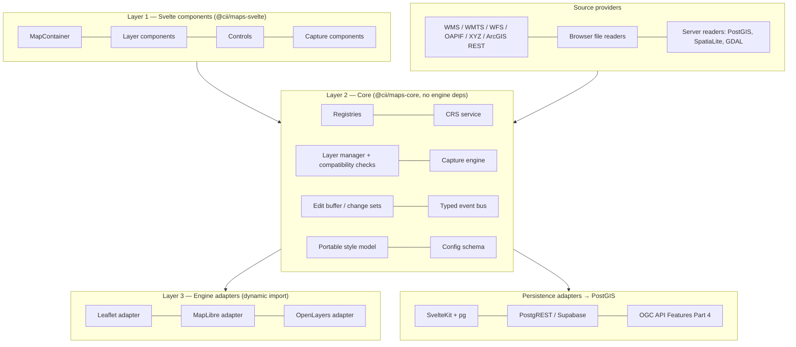

# Svelte Unified Mapping Components — Development Plan

|                   |                                                                             |
| ----------------- | --------------------------------------------------------------------------- |
| **Status**        | Draft for review — v0.3 (review findings from `sources/compare.md` applied) |
| **Date**          | 1 November 2026                                                             |
| **Engines**       | Leaflet, MapLibre GL JS, OpenLayers                                         |
| **Framework**     | Svelte 5 (runes) / SvelteKit                                                |
| **Spatial store** | PostGIS (authoritative output)                                              |

## Decisions already taken for this plan

- Default display CRS is **EPSG:3857**. It can be changed per map, subject to what each engine can render (§5.5).
- Writes to PostGIS go through a **pluggable persistence adapter**. Three adapters are specified: SvelteKit server endpoints, Supabase/PostgREST, and OGC API – Features (§10).
- File inputs use **hybrid readers**. Light formats are parsed in the browser. SpatiaLite and large files are read on the server. Both sides use the same reader interface (§7).
- The library is **headed for production use**. Leaflet is therefore targeted at **1.9.4 (stable)**. Leaflet 2.0 is tested continuously in CI and adopted only once it reaches a release candidate and passes the switch criteria (§6.3).
- The library is part of the **CII design system**. It is published under `@cii/*`, uses `@cii/svelte` components and `--cii-*` tokens, and follows `data-cii-theme` (§15.5).

## Implementation progress — 4 November 2026

Phase 0 is under way in `@cii/maps` and `@cii/maps-server` (see `packages/maps/README.md` and `packages/maps-server/README.md` in the repository). Both are private npm workspaces integrated into the existing build, type checks and Node test runner.

- Implemented the ordered extension registry, CRS provider registry, generated core/Australian definitions, source CRS confirmation and provenance, source-boundary axis swapping, resolution/zoom helpers, a view-only fake engine and reusable view conformance checks.
- Added a server metadata helper that distinguishes a database SRID from its CRS authority and requires a declaration for SRID 0.
- Added a canonical draft-07 JSON Schema with generated `MapConfig`/`SourceConfig` types, standalone validation at `@cii/maps/config`, safe display defaults, attribution enforcement and layer/capture reference validation. Generated types are checked for drift. The §12.5 example is validated by the test suite; its URL-backed GeoPackage layer now includes attribution. Validation covers config structure and references; provider-specific options, file contents, full style rules and extension schema merging are still pending.
- Implemented the full §6 `IMapEngine` contract and supporting engine/layer/interaction/style types, a lazy instance-scoped engine registry, a complete contract fake and adapter lifecycle tests. Added the layer manager with public renderer registration, runtime `ConfirmedCrs` enforcement, grid/service/engine/style compatibility checks, ordered queued attachment, surgical updates, reload, cancellation and deterministic resource cleanup. Display-CRS switch preflight checks registered layers and retained staged-edit targets without mutating state. Rendering and switch/rebuild orchestration remain work for the production adapters and map-state coordinator.
- Added the proj4-backed horizontal display transform service through the CRS registry, with explicit source/display handling, geometry copies, datum/epoch reports and an optional same-datum policy. Generated definitions now include geodetic datum identities, distinguishing GDA94 from GDA2020 despite their matching ellipsoids. Projection tests use 15 checked-in same-datum PROJ CLI fixtures; no PostGIS accuracy certification is claimed. Named grids are rejected until vetted grid integration is available. Authoritative server pipeline/grid checks remain spike S7.
- Corrected the GDA94 zone 59 identifier to **EPSG:6738** after generation with PROJ rejected EPSG:28359. The zone 59 identifier is also listed in [Esri's projected coordinate system catalogue](https://doc.arcgis.com/es/allsource/1.0/visualization/pdf/projected_coordinate_systems.pdf).

Phase 0 is **not complete**. Remaining work includes extension schema merging, remaining typed subsystem registries, Leaflet version CI, and spikes S1–S8. Vetted client grid integration and authoritative PostGIS comparisons remain outstanding. No rendering component or production engine adapter exists yet. Decisions D1–D6 remain open; the database declaration override implements the draft's proposed policy without closing D1.

## Status of the earlier specification

This plan **supersedes** [mapping-components-spec.md](./mapping-components-spec.md) (v0.1). Where the two documents disagree, this plan wins. These parts of the earlier spec remain in force, and have been folded into this plan:

| Earlier spec section                                                                     | Carried forward to |
| ---------------------------------------------------------------------------------------- | ------------------ |
| §4.2 zoom normalisation                                                                  | §6.4 view contract |
| §5.3 style rule labels and precedence                                                    | §7.4               |
| §7.2 `<CiiMap>` behaviour (controlled view, reconciliation, queued registration, resize) | §12.2              |
| §8.5 drafts                                                                              | §9.6               |
| §8.6 accessible capture, §10 accessibility                                               | §15.4              |
| §9 theming                                                                               | §15.5              |
| §13 security, keys and attribution                                                       | §15.6              |

Everything else in the earlier spec (Terra Draw, WGS 84-only public geometry, the generic `CaptureSink`) is **replaced** by this plan. Its single `@cii/maps` package with engine subpath exports is kept as the starting layout (decision D9). Scope items it listed that are not in this plan are recorded as retained, deferred or removed in §16.1.

---

## Contents

1. Purpose and scope
2. Absolute requirements and acceptance criteria
3. What changed from the reference material
4. Architecture overview
5. CRS subsystem (requirements R1, R2)
6. Engine adapter contract
7. Data sources and layers (requirement R5, inputs)
8. Controls without external plugins (requirement R3)
9. Spatial data capture and editing
10. Persistence to PostGIS (requirement R5, outputs)
11. Extensibility model (requirement R4)
12. Svelte component API and configuration schema
13. Packages and technology baseline
14. Testing and conformance
15. Performance, SSR, accessibility, theming and security
16. Delivery roadmap
17. Dependency flags and risk register

- Appendix A — Validation register for the reference documents
- Appendix B — Sources
- Document history

---

## 1. Purpose and scope

This plan sets out how to build a family of Svelte components that:

- display maps from many sources, including web services, PostGIS, GeoPackage, SpatiaLite and raw files;
- render through any of the three major open-source engines, behind one component API;
- scale from a simple basemap with overlays up to full spatial data capture, where edits become PostGIS rows;
- are extensible, so new controls, data types, capture modes and backends can be added without changing the core.

**Out of scope for 1.0:** topology editing (shared boundaries, network editing), 3D, offline sync, printing, and proprietary engines. The extension model in §11 is designed so these can be added later.

### 1.1 Design stance

The reference documents disagree on one point: should the library offer _one API across engines_ or _thin per-engine wrappers_? This plan takes a middle path:

- **One API** for everything the five requirements touch: CRS, layers, controls, capture and persistence. These must behave the same on every engine, or the requirements cannot be guaranteed.
- **An explicit capability model.** Each engine declares what it can do, and the core refuses unsupported combinations with a clear error. It never silently degrades. For example, it will not quietly fall back to EPSG:3857.
- **An escape hatch** (`engine.native()`) for engine-specific power use. Anything done through it is outside the guarantees.

---

## 2. Absolute requirements and acceptance criteria

Each requirement is turned into testable acceptance criteria. These criteria form part of the conformance suite (§14).

### R1 — Input CRS is confirmed when a layer is created

| ID   | Acceptance criterion                                                                                                                                                                                                                                                                                                                           |
| ---- | ---------------------------------------------------------------------------------------------------------------------------------------------------------------------------------------------------------------------------------------------------------------------------------------------------------------------------------------------- |
| R1.1 | `LayerManager.add()` rejects any layer whose source does not have a `ConfirmedCrs` (error `CRS_NOT_CONFIRMED`). There is no default and no assumption.                                                                                                                                                                                         |
| R1.2 | For web services, the CRS comes from service metadata (capabilities document, collection metadata or REST service description). The provenance record names the document and the element it was read from.                                                                                                                                     |
| R1.3 | For all other sources (files, GeoPackage, SpatiaLite, inline data), the creator must declare the CRS. Any CRS embedded in the file (`.prj`, `gpkg_spatial_ref_sys`, a FlatGeobuf header, the RFC 7946 default) is offered only as a **pre-filled suggestion**. If the declaration and the embedded hint disagree, a blocking warning is shown. |
| R1.4 | If a service advertises several CRSs, the choice is made by an explicit, documented policy (§5.4). The chosen CRS is recorded.                                                                                                                                                                                                                 |
| R1.5 | Axis order is part of the confirmed CRS record. Example: WMS 1.3.0 with EPSG:4326 uses latitude/longitude order.                                                                                                                                                                                                                               |
| R1.6 | The confirmed CRS and its provenance can be serialised in the map configuration and inspected at runtime.                                                                                                                                                                                                                                      |

### R2 — Display CRS is configurable, with a specified default

| ID   | Acceptance criterion                                                                                                                                                                                                                                                                                                                                                          |
| ---- | ----------------------------------------------------------------------------------------------------------------------------------------------------------------------------------------------------------------------------------------------------------------------------------------------------------------------------------------------------------------------------- |
| R2.1 | `display.crs` defaults to `EPSG:3857`.                                                                                                                                                                                                                                                                                                                                        |
| R2.2 | Any CRS in the CRS registry can be requested. The active engine answers `native`, `experimental` or `unsupported` (§5.5). `unsupported` is a hard error, and the core never substitutes another CRS.                                                                                                                                                                          |
| R2.3 | Each layer is checked for compatibility with the display CRS when it is added. Examples: a raster tile grid that does not match the display CRS, or a WMS that does not offer the display CRS. Incompatible layers are rejected with a reason.                                                                                                                                |
| R2.4 | Changing the display CRS at runtime is supported. Engines that cannot switch in place rebuild the map, and layer and capture state are preserved. A switch that would make any layer incompatible, or any staged edit's target layer incompatible, is refused before anything changes (`DISPLAY_CRS_SWITCH_BLOCKED`, naming the layers). The map is never left half-switched. |

### R3 — Avoid external plugins or libraries for controls

| ID   | Acceptance criterion                                                                                                                                                                       |
| ---- | ------------------------------------------------------------------------------------------------------------------------------------------------------------------------------------------ |
| R3.1 | Every control (navigation, scale, attribution, layer list, legend, draw, edit, snap, measure, identify and others) is a first-party Svelte component built on the engine adapter contract. |
| R3.2 | No engine plugin is used for drawing or editing. This excludes Leaflet-Geoman, Leaflet.draw, Terra Draw and Mapbox GL Draw forks. Capture uses a first-party engine (§9).                  |
| R3.3 | Any third-party library that remains is listed in the dependency register (§17) with a justification. None of them provide controls.                                                       |

### R4 — The whole system is extensible

| ID   | Acceptance criterion                                                                                                                                                                  |
| ---- | ------------------------------------------------------------------------------------------------------------------------------------------------------------------------------------- |
| R4.1 | Engines, CRS definition providers, source providers, layer renderers, controls, capture modes, validators, persistence adapters and exporters are all added through registries (§11). |
| R4.2 | Built-in features are registered through the same public registries that third parties use. Nothing is hard-wired.                                                                    |
| R4.3 | A new data type that produces an existing render kind (for example, features) needs **no engine-specific code**.                                                                      |

### R5 — PostGIS for outputs; multiple input types

R5.1, R5.2 and R5.5 define a **conformant** persistence adapter. Editing is enabled only through a conformant adapter, unless the target explicitly opts out (R5.6).

| ID   | Acceptance criterion                                                                                                                                                                                                                                                                                  |
| ---- | ----------------------------------------------------------------------------------------------------------------------------------------------------------------------------------------------------------------------------------------------------------------------------------------------------- |
| R5.1 | The result of a capture or edit is an insert, update or delete of a PostGIS row. The geometry is transformed to the target column's SRID **on the server by PostGIS**.                                                                                                                                |
| R5.2 | The target table description (primary key, geometry column, geometry type, SRID, attribute columns, version column) is read from the database, not hand-configured.                                                                                                                                   |
| R5.3 | Inputs are supported from PostGIS, GeoPackage, SpatiaLite, Shapefile, GeoJSON, KML, GPX, CSV (XY or WKT) and OGC/REST services. Each one goes through the R1 CRS confirmation.                                                                                                                        |
| R5.4 | Commits are atomic where the backend allows it. Partial-failure behaviour is defined where it does not (§10.5), and every operation has its own result (§10.1).                                                                                                                                       |
| R5.5 | Concurrent edits are detected through optimistic concurrency, using a version column or ETag.                                                                                                                                                                                                         |
| R5.6 | Opening a capture session on an adapter that does not meet R5.1, R5.2 and R5.5 fails with `PERSISTENCE_NOT_CONFORMANT`, naming the unmet criteria. The target may set `allowNonConformantPersistence: true` to accept this. The UI then shows a persistent warning that names the missing guarantees. |

---

## 3. What changed from the reference material

The four reference artefacts (the Gemini spec, the design guide, the development guide, the Word spec and the architecture diagram) were checked against current documentation. The full register is in **Appendix A**. The corrections that change the design are:

1. **The drawing plugins named in the references are dropped.** Geoman, Terra Draw and Mapbox GL Draw forks conflict with R3. They also carry version risk: Terra Draw's README lists adapters for Leaflet v1 and MapLibre v4/5 only, not MapLibre v6 or Leaflet 2. This plan specifies a first-party capture engine instead.
2. **MapLibre is no longer "EPSG:3857 only".**
   - v5 added globe.
   - v6.15 (October 2026) added an **experimental** `addProjection` API for one custom CRS per map.
   - Tiles must already be in that CRS. MapLibre positions them but does not reproject them.
   - proj4 must also be loaded into MapLibre's web workers.
3. **The MapLibre version is now 6.x.** It was released in July 2026, is ESM-only and requires WebGL2. The references cite 4.x/5.x.
4. **Leaflet is not "3857/4326 only".**
   - It accepts custom CRS objects. Proj4Leaflet is just a plugin that builds one, and it targets Leaflet 1.0.3.
   - This plan builds the custom CRS first-party instead.
   - The current stable release is still **1.9.4** (May 2023). 2.0 is at alpha.1 (August 2025): ESM, no global `L`, factory methods removed.
   - Because the library is going to production, the adapter targets 1.9.4 and is written so the move to 2.0 is cheap (§6.3).
5. **"MapLibre has no native WMS – must proxy" is wrong.** MapLibre's own example adds WMS as a raster source using a `{bbox-epsg-3857}` URL template. The real constraint is that the WMS must serve the display CRS.
6. **OpenLayers is at 10.11.0** (October 2026). The references cite 9.x.
7. **Silent CRS fallback is removed.** The development guide falls back to 3857 with a warning, which violates R1 and R2.
8. **Capture output is not "always EPSG:4326 GeoJSON".**
   - Geometry stays in the capture CRS, with that CRS explicitly tagged.
   - PostGIS does one authoritative transform to the target SRID.
   - GeoJSON is used only as a transport encoding.
9. **The Svelte 4 idioms in the references** (`on:create`, `createEventDispatcher`, slots) are replaced with Svelte 5 callback props, snippets, `createContext` (5.40+) and attachments (5.29+).
10. **Persistence options were checked.**
    - pg_featureserv's transaction support (PR #152) is still unmerged.
    - GeoSolutions' GeoServer training material states that GeoServer has no OGC API – Features transaction implementation.
    - pygeoapi's PostgreSQL provider _does_ support transactions, but authentication is out of its scope.
11. **The datum issue is made explicit.** NSW Spatial Services documents about 1.8 m misalignment when GDA94 and GDA2020 data are both pushed through WGS 84 / Web Mercator. The EPSG null transformations are rated at 3 m. This shapes the transform policy in §5.6.

---

## 4. Architecture overview

The layering in the supplied diagram is kept: Svelte components → core → engine adapters, with a factory that dynamically imports the chosen adapter. The diagram is extended with five subsystems it did not show:

- the **CRS service**;
- **source providers**;
- the **capture engine**;
- the **edit buffer**;
- **persistence adapters**.

The Geoman and TerraDraw boxes in the diagram are replaced by a shared, first-party capture engine.



### Key flows

1. **Layer creation:**
   - The source provider probes the source and returns a `CrsHint` or metadata-derived CRS.
   - For non-service sources, the creator confirms the CRS (`ConfirmedCrs`).
   - The layer manager checks compatibility with the display CRS and the engine's capabilities.
   - The engine adapter renders a _resolved layer_.
2. **Capture:**
   - The adapter's `InteractionSurface` emits pointer events in the display CRS.
   - The capture engine runs a mode state machine and renders the sketch through the adapter.
   - Validators run, and the finished geometry is staged in the edit buffer.
   - The persistence adapter commits the change set, and PostGIS transforms the geometry and stores the row.
   - The stored row is returned and reconciled on the map.

---

## 5. CRS subsystem (requirements R1, R2)

The CRS subsystem is the backbone of the design. It lives in core and has no engine dependencies. It uses **proj4js** for client-side coordinate maths; this is a flagged dependency, see §17.

### 5.1 Types

```ts
// @cii/maps-core/crs/types.ts
export type CrsCode = string; // 'EPSG:7856', 'OGC:CRS84', 'EPSG:3857'

export interface CrsRef {
  code: CrsCode;
  wkt?: string; // WKT/WKT2 when supplied by metadata or file
  axisOrder: 'xy' | 'yx'; // order as DELIVERED by this source
  epoch?: number; // coordinate epoch, for dynamic CRSs (optional)
}

export type CrsProvenance =
  | { kind: 'service-metadata'; url: string; element: string } // e.g. WMS Layer/CRS, OAPIF storageCrs
  | { kind: 'database-metadata'; table: string; column: string; srid: number } // PostGIS geometry_columns
  | {
      kind: 'declared';
      by: string;
      hint?: CrsHint;
      hintMismatchAcknowledged?: boolean;
    };

export interface CrsHint {
  // never trusted on its own (R1.3)
  code?: CrsCode;
  wkt?: string;
  from:
    | 'prj'
    | 'gpkg_spatial_ref_sys'
    | 'spatialite_spatial_ref_sys'
    | 'flatgeobuf_header'
    | 'rfc7946_default'
    | 'kml_spec'
    | 'gpx_spec'
    | 'none';
}

export interface ConfirmedCrs {
  crs: CrsRef;
  provenance: CrsProvenance;
  confirmedAt: string; // ISO timestamp, stamped by resolveSourceCrs()
}

// What a serialised config carries (§12.5). Not yet confirmed.
export type CrsDeclaration =
  | {
      code: CrsCode;
      axisOrder?: 'xy' | 'yx';
      provenance: { kind: 'declared'; by: string };
    }
  | { fromMetadata: true; policy?: CrsSelectionPolicy }; // service and PostGIS providers only

export type CrsSelectionPolicy = 'prefer-display' | 'prefer-native';

// Probes the source when needed, applies R1.2–R1.5 and returns a ConfirmedCrs
// or a typed error (CRS_NOT_CONFIRMED, CRS_HINT_MISMATCH, CRS_DECLARATION_NOT_ALLOWED).
export function resolveSourceCrs(
  source: SourceConfig,
  ctx: ProbeContext
): Promise<Result<ConfirmedCrs, MapError>>;
```

There are two source types, one before CRS resolution and one after:

- **`SourceConfig`** is the serialised form used in config and JSON Schema (§12.5). It carries a `CrsDeclaration`.
- **`SourceSpec`** is the resolved form that the layer manager accepts. It carries a `ConfirmedCrs`. The only way to produce one is `resolveSourceCrs()`, or a provider's `probe()` for metadata-derived CRSs.

`ConfirmedCrs` is therefore required on every `SourceSpec`. The TypeScript types make it a compile-time error to pass a `SourceConfig` where a `SourceSpec` is expected, and the layer manager also enforces it at runtime (R1.1).

### 5.2 CRS registry and definition providers

The registry resolves a `CrsCode` to a proj4 definition plus metadata: units, extent, geographic base, and whether the CRS is projected. Definition providers are themselves registered (R4), and are queried in order:

1. **Bundled set.** Core always ships EPSG:3857, EPSG:4326 and OGC:CRS84. Regional definitions ship as separate, optional **CRS packs**, registered like any other definition provider, so an organisation loads only the pack for its jurisdiction. Each definition string is generated from PROJ during the build and checked in, not typed by hand.
   - The Australian pack covers EPSG:7844 (GDA2020 geographic), EPSG:7854–7859 (GDA2020 MGA zones 54–59), EPSG:8058 (GDA2020 NSW Lambert), EPSG:4283 (GDA94), EPSG:28354–28358 (GDA94 MGA zones 54–58) and EPSG:6738 (GDA94 MGA zone 59).
   - **The Australian pack is the first-class target (decision D8, §17.3).** It is installed by default, and the datum guidance (§5.6), fixtures and spikes are written for it. Other packs, such as a UK pack with EPSG:27700, can be added later as extensions.
2. **PostGIS `spatial_ref_sys`.** A server endpoint returns `proj4text` and `srtext` for a given SRID. This makes the database the organisation's CRS authority, and it covers custom SRIDs.
3. **Optional online lookup**, for example a spatialreference.org or MapTiler lookup. This is **disabled by default**, so an application never depends on a third-party site at runtime.

> OpenLayers' `ol/proj/proj4` module looks up definitions on spatialreference.org by default. The OL adapter must call `setProjectionCodeLookup()` with the core registry, so all three engines use exactly the same definitions.

### 5.3 Confirmation workflow (R1)

```text
SourceProvider.probe(input)
   ├─ web service  → reads metadata → ConfirmedCrs{provenance: service-metadata}   (auto, recorded)
   ├─ PostGIS      → geometry_columns.srid → ConfirmedCrs{provenance: database-metadata}
   │                 (srid = 0 or untyped column → treated as "declare required")
   └─ everything else → CrsHint (suggestion only)
                          → creator confirms via <CrsConfirm> UI or `crs` in config
                          → mismatch with hint ⇒ blocking warning, must acknowledge
```

- **In the UI:** `<CrsConfirm>` shows the hint, its source, a sample coordinate decoded with that CRS, and the layer's extent drawn on the map. Showing the extent catches wrong-zone and swapped-axis errors immediately.
- **In config-driven maps:** the creator states `crs` in the layer config. This counts as a declaration, and probing still runs so the mismatch warning can fire.
- **Open decision (§17, D1):** whether PostGIS should count as "metadata-derived" or "declared". This plan treats it as metadata-derived because `geometry_columns` is authoritative. A `requireDeclaration` flag lets an organisation force a declaration anyway.

### 5.4 Where the CRS comes from, per source type

| Source                                  | Where the CRS is read                                                                                                             | Notes and policy                                                                                                                                                                                          |
| --------------------------------------- | --------------------------------------------------------------------------------------------------------------------------------- | --------------------------------------------------------------------------------------------------------------------------------------------------------------------------------------------------------- |
| **WMS 1.1.1 / 1.3.0**                   | `<SRS>` (1.1.1) or `<CRS>` (1.3.0) elements in GetCapabilities, which are inherited down the layer tree                           | **Policy:** request the display CRS if it is advertised. If not, the layer is OL-only (OL reprojects rasters) or is rejected. WMS 1.3.0 with EPSG:4326 uses lat/lon axis order, so set `axisOrder: 'yx'`. |
| **WMTS**                                | `TileMatrixSet/SupportedCRS`                                                                                                      | **Policy:** choose a matrix set whose CRS and grid match the display CRS. Leaflet and MapLibre cannot reproject tiles.                                                                                    |
| **WFS 1.1 / 2.0**                       | `DefaultCRS` / `OtherCRS` (2.0), `DefaultSRS` / `OtherSRS` (1.1)                                                                  | **Policy:** prefer the native default CRS and transform in core. Request the display CRS if the server offers it and the layer is display-only.                                                           |
| **OGC API – Features**                  | Collection `crs` list and `storageCrs` (Part 2); the response header `Content-Crs`                                                | GeoJSON with no `crs` parameter is CRS84. Record `Content-Crs` from the actual response, not only from metadata.                                                                                          |
| **ArcGIS REST** (Map/Feature Server)    | `spatialReference.wkid` / `latestWkid` / `wkt`                                                                                    | Use `latestWkid` when it is present.                                                                                                                                                                      |
| **XYZ / TMS raster, TileJSON, PMTiles** | No CRS member in TileJSON or in the PMTiles header                                                                                | These have no CRS in their metadata. The convention is a Web Mercator grid, but per R1 the creator must **declare** it. The default suggestion is EPSG:3857.                                              |
| **Vector tiles (MVT)**                  | As for XYZ                                                                                                                        | Same rule: the tile grid CRS must be declared.                                                                                                                                                            |
| **PostGIS** (through the server)        | `geometry_columns.srid`, `Find_SRID()`                                                                                            | `srid = 0` or an untyped geometry column means a declaration is required.                                                                                                                                 |
| **GeoPackage**                          | `gpkg_geometry_columns.srs_id` → `gpkg_spatial_ref_sys` (organisation, coordsys id, definition)                                   | Hint only. `srs_id` −1 or 0 means undefined, so a declaration is required.                                                                                                                                |
| **SpatiaLite**                          | `geometry_columns.srid` → `spatial_ref_sys`                                                                                       | Hint only.                                                                                                                                                                                                |
| **Shapefile**                           | `.prj` (ESRI WKT)                                                                                                                 | Hint only. ESRI WKT names often don't match EPSG names, so show both.                                                                                                                                     |
| **GeoJSON**                             | RFC 7946 says the CRS is always WGS 84 lon/lat; the legacy `crs` member was removed from the spec but still appears in some files | Hint: CRS84, or the legacy member if it is present. Many real files are in MGA, so a declaration is always required.                                                                                      |
| **KML / GPX**                           | The specifications fix the CRS as WGS 84 lon/lat                                                                                  | The hint is pre-filled, and the creator still confirms (R1.3).                                                                                                                                            |
| **CSV** (XY or WKT columns)             | None                                                                                                                              | Always declared.                                                                                                                                                                                          |
| **FlatGeobuf** (phase 4)                | The header contains CRS info (org, code, WKT)                                                                                     | Hint only.                                                                                                                                                                                                |

### 5.5 Display CRS: engine capability matrix (R2)

| Capability                                         | Leaflet 1.9.4                                                                                                                | MapLibre GL JS 6.x                                                                                                                                                  | OpenLayers 10.x                                      |
| -------------------------------------------------- | ---------------------------------------------------------------------------------------------------------------------------- | ------------------------------------------------------------------------------------------------------------------------------------------------------------------- | ---------------------------------------------------- |
| EPSG:3857 (default)                                | native                                                                                                                       | native                                                                                                                                                              | native                                               |
| EPSG:4326 / plate carrée                           | native (`CRS.EPSG4326`)                                                                                                      | unsupported                                                                                                                                                         | native                                               |
| Arbitrary projected CRS (e.g. MGA 56, NSW Lambert) | **native via a first-party custom `CRS` object** that extends Leaflet's CRS with a proj4-backed projection. No Proj4Leaflet. | **experimental** (6.15 `addProjection`): one CRS per map, flat (no globe or world copies), square quadtree grid, proj4 also in the workers, set before sources load | native (proj4 registered)                            |
| Raster tile reprojection                           | no; tile grid must match                                                                                                     | no; "map positions the tiles, it doesn't reproject them"                                                                                                            | **yes** (built-in raster reprojection)               |
| WMS in the display CRS                             | yes, if the server offers it                                                                                                 | yes (`{bbox-epsg-3857}` template for 3857; custom CRS needs the bbox computed by the adapter, which is part of spike S1)                                            | yes                                                  |
| Vector features from any CRS                       | yes; core transforms to the engine's input space                                                                             | yes; core transforms to lon/lat                                                                                                                                     | yes; OL transforms                                   |
| Vector tiles in a CRS other than display           | no                                                                                                                           | no                                                                                                                                                                  | treat as unsupported until spike S3 proves otherwise |
| Switch display CRS at runtime                      | rebuild the map                                                                                                              | rebuild the map (the projection must be set before sources load)                                                                                                    | swap the `View`                                      |

#### Rules enforced by core

- `engine.capabilities.displayCrs(code)` returns `'native' | 'experimental' | 'unsupported'`.
  - `'experimental'` requires `display.allowExperimental: true` in config and logs a one-time warning.
  - `'unsupported'` throws `DISPLAY_CRS_UNSUPPORTED` and names the engines that _do_ support the CRS.
- `layerManager.checkCompatibility(layer, displayCrs, engine)` returns one of:
  - `direct`;
  - `client-transform` (vector features);
  - `server-request` (WMS/WFS that can serve the display CRS);
  - `engine-reproject` (OL rasters);
  - `incompatible` (with a reason).
- **Runtime switch:** `MapState.setDisplayCrs()` works in three steps:
  1. **Pre-check.** It runs `checkCompatibility` for every layer, and for the target layer of every staged edit, against the new CRS. If any of them returns `incompatible`, the switch is refused with `DISPLAY_CRS_SWITCH_BLOCKED` (R2.4). Nothing is changed. The user can remove those layers, or commit or discard the staged edits, and then try again.
  2. **Snapshot.** It records the view (centre converted to the new CRS, scale preserved), the layer specs and the capture state.
  3. **Apply.** It asks the adapter to reconfigure or rebuild. If that fails, the snapshot is restored in the old CRS and the error is reported.
- Staged edits keep the CRS they were captured in (§9.4). A switch therefore never transforms staged geometry. The edit buffer can hold edits in more than one CRS, and each operation carries its own `geometryCrs` (§10.1).

### 5.6 Transform policy and datum handling

The rule is **two tiers of transformation**:

| Tier          | Where          | Library        | Used for                                                                       | Accuracy expectation                                                                          |
| ------------- | -------------- | -------------- | ------------------------------------------------------------------------------ | --------------------------------------------------------------------------------------------- |
| Display       | Browser        | proj4js        | Drawing vector layers, cursor readout, snap _search_, freehand sketch geometry | Good enough for screen display. proj4js does not apply NTv2 grids unless they are configured. |
| Authoritative | PostGIS (PROJ) | `ST_Transform` | Every write (R5.1) and any read that a downstream calculation depends on       | The organisation's configured PROJ pipeline, including grids where they are installed         |

#### Precision rules for captured geometry

A browser transform cannot be undone without loss. So geometry that will be stored must not depend on one wherever that can be avoided:

1. **Snapped vertices keep their source coordinates.** The snap index holds each feature's original coordinates in its source CRS, next to the display-CRS copy it uses for searching. When a vertex snaps, the edit buffer records the snap target: layer, feature identity, vertex or segment index, and the original coordinate in the source CRS. On commit, the server rebuilds that vertex from the original coordinate with `ST_Transform`. The display-transformed point is used only for drawing.
2. **Freehand vertices are display-accuracy.** A vertex that is not snapped is digitised in the display CRS. It is tagged as such, and its accuracy is that of the display CRS and the screen resolution. The attribute form and commit panel say so when the target has a stated accuracy requirement.
3. **Attribute-only edits never send geometry.** The edit buffer omits `geometry` from an update unless the geometry itself was changed. So stored geometry is never round-tripped through display coordinates.
4. **Untouched vertices of a modified feature keep their stored coordinates.** When a modify edit moves some vertices, the others are sent as references to the stored geometry, not as display coordinates (see `VertexRef` in §10.1).

#### Datum considerations (Australia)

- EPSG:3857 and EPSG:4326 sit on the WGS 84 _ensemble_. NSW Spatial Services notes that the null transformations between WGS 84 and GDA94/GDA2020 are rated at 3 m. It also notes about 1.8 m misalignment when GDA94 and GDA2020 data are both pushed through Web Mercator, and the plate moves about 7 cm per year.
- **Consequences for this design:**
  1. The CRS registry records the geodetic datum of every confirmed CRS. The layer list shows a "datum differs from display" badge when a layer's datum differs from the display CRS datum.
  2. Captured geometry is tagged with the **display CRS it was digitised in**, together with the _capture context_: the reference layers that were snapped to or visible, their CRSs, and the original coordinates of every snapped vertex (rule 1 above). The server can then apply the correct transformation rather than a blind null transform.
  3. Workflows that need sub-metre accuracy should use a **GDA2020 display CRS (OpenLayers)**, so digitising happens in the authoritative datum. This is the main reason to keep OpenLayers as a first-class engine.

### 5.7 Coordinate conventions inside core

- Core always holds coordinates in **x/y (easting/longitude first)** order, in a named CRS.
- Axis swapping happens _only_ at the source-provider boundary, driven by `CrsRef.axisOrder`.
- View centres in config are written as `{ crs, coordinates }`. This removes the `[lat, lng]` versus `[lng, lat]` inconsistency in the architecture diagram.

---

## 6. Engine adapter contract

The adapter is the only code that touches an engine API. The Svelte components and the core use only this contract.

```ts
// @cii/maps-core/engine/types.ts
export type EngineId = 'leaflet' | 'maplibre' | 'openlayers' | (string & {});

export interface EngineCapabilities {
  displayCrs(code: CrsCode): 'native' | 'experimental' | 'unsupported';
  renderKinds: ReadonlySet<RenderKind>; // 'raster-tiles' | 'raster-image' | 'vector-tiles' | 'features' | ...
  rasterReprojection: boolean;
  rotation: boolean; // bearing support
  styleFeatures: ReadonlySet<StyleFeature>; // e.g. 'dash', 'pattern-fill', 'halo-label'
}

export interface IMapEngine {
  readonly id: EngineId;
  readonly capabilities: EngineCapabilities;

  mount(container: HTMLElement, init: EngineInit): Promise<void>; // init.displayCrs is a resolved CrsDef
  reconfigure?(change: {
    displayCrs?: CrsDef;
  }): Promise<'done' | 'rebuild-required'>;
  destroy(): void; // idempotent
  resize(): void; // container size changed

  // View — always in display CRS
  getView(): ViewState; // { center: Coord, resolution, zoom?, rotation, extent } — see §6.4
  setView(v: Partial<ViewState>, o?: { animate?: boolean }): void;
  fitExtent(e: Extent, o?: { padding?: number; maxZoom?: number }): void;

  // Coordinate plumbing used by capture + controls
  pixelToCoord(px: Pixel): Coord;
  coordToPixel(c: Coord): Pixel;
  resolutionAt(c: Coord): number; // map units per CSS pixel, for snapping tolerance & scale bar

  // Layers (already resolved by core into a render kind + engine-ready data)
  addLayer(layer: ResolvedLayer): LayerHandle;

  // Interaction surface for first-party controls and the capture engine
  readonly interaction: InteractionSurface;

  on<K extends keyof EngineEvents>(
    type: K,
    cb: (e: EngineEvents[K]) => void
  ): () => void;
  native<T = unknown>(): T; // escape hatch — outside guarantees
}

export interface LayerHandle {
  setVisible(v: boolean): void;
  setOpacity(o: number): void;
  setOrder(index: number): void;
  setStyle(s: PortableStyle): void;
  setData?(d: FeatureBatch): void; // 'features' kind only — surgical update
  remove(): void;
}

export interface InteractionSurface {
  onPointer(h: (e: MapPointerEvent) => void): () => void; // down|move|up|click|dblclick|contextmenu; coord in display CRS
  onKey(h: (e: KeyboardEvent) => void): () => void;
  setCursor(c: string | null): void;
  suspend(
    nav: Array<'dragPan' | 'dblClickZoom' | 'boxZoom' | 'keyboard'>
  ): () => void;
  sketch(): SketchRenderer; // engine-native vector overlay for drafts/handles/snap marker
  hitTest(
    px: Pixel,
    o: { layers?: string[]; tolerancePx: number }
  ): FeatureHit[];
}
```

### 6.1 Factory and dynamic import

The architecture diagram's factory pattern is kept, but the factory reads from the engine registry rather than a hard-coded switch. This makes new engines pluggable (R4).

```ts
// @cii/maps-core/engine/registry.ts
const loaders = new Map<
  EngineId,
  () => Promise<{ default: EngineConstructor }>
>();

export const engineRegistry = {
  register(id: EngineId, load: () => Promise<{ default: EngineConstructor }>) {
    loaders.set(id, load);
  },
  async create(id: EngineId): Promise<IMapEngine> {
    const load = loaders.get(id);
    if (!load) throw new MapError('ENGINE_NOT_REGISTERED', { id });
    const { default: Engine } = await load();
    return new Engine();
  }
};

// registered by the app (or a convenience preset), so unused engines are never bundled
engineRegistry.register('leaflet', () => import('@cii/maps-engine-leaflet'));
engineRegistry.register('maplibre', () => import('@cii/maps-engine-maplibre'));
engineRegistry.register(
  'openlayers',
  () => import('@cii/maps-engine-openlayers')
);
```

Vite code-splits each `import()` into its own chunk. Each engine is a **peer dependency** of its adapter package.

### 6.2 Per-engine implementation notes

**Leaflet adapter** (production target: 1.9.4; 2.0 tracked in CI — see §6.3)

- Use constructors and named ESM imports (`new Map(...)`, `new TileLayer(...)`), never the factory functions (`L.map`). Leaflet 2.0 removes the factory methods and the global `L`, so this keeps the migration to a version bump.
- For a custom display CRS, write first-party code: a `CRS` object with a projection object whose `project` and `unproject` call the core CRS service (proj4), plus a `transformation`, resolutions and origin taken from the tile matrix set.
  - This is roughly what Proj4Leaflet does. Owning the code removes a plugin that targets Leaflet 1.0.3.
  - Spike S2 must prove it works on both 1.9.4 and 2.0-alpha. This code is the part most exposed to 2.0 changes (§6.3).
- Leaflet takes `LatLng` input, so core transforms features to the geographic base of the display CRS before passing them to Leaflet.
- The sketch renderer uses a dedicated `Pane` with `Polyline`, `Polygon` and `CircleMarker` on a Canvas renderer.
- `hitTest` uses a layer-level spatial index in core, because Leaflet has no rendered-feature query.
- No vector tiles in 1.0 (see F4).

**MapLibre adapter** (target: 6.x)

- v6 is ESM-only and requires WebGL2. Document the WebGL2 requirement as a browser baseline.
- Wait for `load` before adding sources. Generate stable source and layer IDs (`${mapId}:${layerId}`).
- Make surgical updates through `setPaintProperty`, `setLayoutProperty`, `setFilter` and `GeoJSONSource.setData`. Never rebuild the style for prop changes.
- The portable style compiles to style-spec layers (fill, line, circle, symbol).
- For a custom display CRS:
  - Gate it behind `allowExperimental`.
  - Register the CRS with `maplibregl.addProjection()` using a proj4 converter, before any map is created.
  - Install the worker handler (`setProjectionHandler`).
  - Rebuild the map on CRS change.
- The sketch renderer uses a dedicated GeoJSON source with three layers (lines, fills, vertices) at the top of the stack. `hitTest` uses `queryRenderedFeatures`.

**OpenLayers adapter** (target: 10.x)

- Register proj4 with `ol/proj/proj4.register`, and route definition lookups to the core registry with `setProjectionCodeLookup`.
- Import granular modules only (`ol/Map`, `ol/View`, `ol/layer/Tile`, and so on) so tree-shaking works.
- On CRS change, swap the `View`. Raster reprojection is native.
- The sketch renderer uses a dedicated `VectorLayer` with a style function. `hitTest` uses `forEachFeatureAtPixel` with `hitTolerance`.
- OL's built-in `Draw`, `Modify` and `Snap` interactions are core OL, not plugins, so R3 would allow them. They are **not** used by default, so that capture behaves the same on all engines. They may be added later as an alternative capture backend behind the same `CaptureMode` contract (open decision D3).

### 6.3 Leaflet version policy (production)

**Decision.** Production releases of `maps-engine-leaflet` target **Leaflet 1.9.4**, with the peer range `>=1.9.4 <2`. Leaflet **2.0 is not a production target** until it meets the switch criteria below. It is tested in CI from Phase 0 onwards.

#### Why 2.0 is not the production target

- **The alpha has stalled.** 2.0.0-alpha.1 was released in August 2025, and there has been no beta or release candidate since. The API can still change before 2.0 is final, and there is no published release date.
- **The custom-CRS code is the most exposed.** The first-party custom CRS (MGA, NSW Lambert) builds on Leaflet's `CRS`, `Projection` and `Transformation` objects. Few people use these, so breaking changes there are less likely to be noticed and reported by the wider community.
- **Less support material.** Documentation, examples and community answers are almost all for 1.x.
- **No gain to offset the risk.** This library uses no Leaflet plugins, so 1.9.4 already provides everything the adapter needs. 2.0 adds nothing that the requirements depend on.

#### Why the migration should be cheap

- **No plugins.** Most 2.0 migration pain comes from plugins that rely on the global `L` and the factory methods. R3 avoids that whole class of breakage.
- **One file touches Leaflet.** Components, capture, CRS handling and persistence go through core, so a Leaflet change is contained in the adapter (§6).

#### Coding rules for the Leaflet adapter

These rules keep 1.9.4 code close to 2.0:

1. Use constructors only (`new Marker(...)`), never factory functions (`L.marker(...)`).
2. Import Leaflet from the ESM build using named imports. Never rely on the global `L`.
3. Route every Leaflet import through one internal module (`leaflet-api.ts`). It is the single seam to change when moving to 2.0.
4. Keep custom-CRS construction in one module (`crs-factory.ts`). If 2.0 changes how CRS objects are built, version-specific implementations can sit behind this one function.
5. Do not use private or undocumented members (anything prefixed `_`). Do not monkey-patch Leaflet prototypes.
6. Keep Leaflet types inside the adapter. Never expose them in the adapter's public API.

#### CI matrix

| Job                   | Leaflet version                                    | Blocking? | Purpose                                                                               |
| --------------------- | -------------------------------------------------- | --------- | ------------------------------------------------------------------------------------- |
| `leaflet-stable`      | 1.9.4                                              | **Yes**   | Production gate: full conformance, capture parity and E2E suites                      |
| `leaflet-next-pinned` | 2.0.0-alpha.1, or the latest tagged 2.0 prerelease | No        | Shows the current migration gap; failures are logged in a "Leaflet 2 readiness" issue |
| `leaflet-next-dev`    | Leaflet development snapshot, weekly               | No        | Early warning of upcoming breaking changes                                            |

**Switch criteria.** All of these must hold before 2.0 becomes the production target:

1. Leaflet 2.0 is published as a **release candidate or stable** release.
2. The full conformance suite (§14) passes on 2.0 as a **blocking** job for four consecutive weeks.
3. Spike S2 (the custom CRS) and the capture parity tests pass on 2.0.
4. The "Leaflet 2 readiness" log has no open items marked breaking.

#### Switching

- Release a new **major version** of `maps-engine-leaflet` with the peer range `^2`.
- Keep the 1.9.4-based major on fixes-only support for a defined window, for example six months, so applications can move at their own pace.
- No other package changes. Core, the Svelte components and the persistence adapters are unaffected.

**Revisit early if** 1.9.4 hits a blocking defect or a security advisory that has no 1.x fix. In that case, review the readiness log to decide whether to move to the 2.0 prerelease or to patch around the problem within the adapter.

### 6.4 View contract

`ViewState` must mean the same thing on every engine, so the conformance suite can compare engines.

- **Resolution is canonical.** `resolution` is display-CRS units per CSS pixel. Engines are compared on resolution, not zoom.
- **Zoom is derived.** `zoom` is defined against the **zoom-to-resolution table of the display CRS**:
  - For EPSG:3857, the table is the 256 px tile convention used by Leaflet and OpenLayers (zoom 0 = 156 543.03 m per pixel at the equator). MapLibre uses 512 px tiles, so its adapter converts with `mapLibreZoom = zoom − 1` at the boundary.
  - For any other display CRS, the table comes from the CRS's configured tile matrix set (resolutions and origin), and fractional zooms interpolate logarithmically between levels. A display CRS with no tile matrix set exposes `resolution` only, and `zoom` is `undefined`.
- **Precedence.** If a `setView` call or config gives both `zoom` and `resolution`, `resolution` wins, and a development warning is logged when they disagree by more than 1%.
- **Limits.** `minZoom`, `maxZoom` and layer zoom ranges use the same table. Each can also be given as a resolution.
- **Tests.** The zoom conversion and the round trip through every adapter are unit-tested. The conformance suite checks that `setView` and `fitExtent` give the same resolution and centre on every engine, within a stated tolerance.

---

## 7. Data sources and layers (requirement R5, inputs)

### 7.1 Provider and render-kind model

Sources and rendering are separate concerns, which is what makes R4.3 possible:

- A **SourceProvider** knows a data type: how to probe it, read its CRS, and load it.
- A **LayerRenderer** knows how to draw one **render kind** on one engine.

| Render kind    | Produced by                                                                                                      | Engine renderers needed                              |
| -------------- | ---------------------------------------------------------------------------------------------------------------- | ---------------------------------------------------- |
| `raster-tiles` | XYZ/TMS, WMTS, WMS (tiled)                                                                                       | 3 (built-in)                                         |
| `raster-image` | WMS (single image), static georeferenced image                                                                   | 3 (built-in)                                         |
| `vector-tiles` | MVT from PostGIS `ST_AsMVT`, Martin, pg_tileserv, PMTiles                                                        | MapLibre and OL built-in; Leaflet unsupported in 1.0 |
| `features`     | GeoJSON, WFS, OAPIF, ArcGIS FeatureServer, PostGIS, GeoPackage, SpatiaLite, Shapefile, KML, GPX, CSV, FlatGeobuf | 3 (built-in)                                         |

A new data type that produces `features` (for example FlatGeobuf, or a CSV variant) needs only a `SourceProvider`.

```ts
export interface SourceProvider<I = unknown> {
  id: string; // 'wms', 'gpkg', 'shapefile', 'postgis', ...
  accepts(input: unknown): input is I; // url patterns, File types, config shapes
  runsIn: 'browser' | 'server' | 'either';
  probe(input: I, ctx: ProbeContext): Promise<ProbeResult>; // layers/tables, extent, CRS (metadata or hint), schema
  open(input: I, crs: ConfirmedCrs, opts: OpenOptions): Promise<ResolvedSource>; // → render kind + loader
}
```

`ProbeResult` carries, for each sub-layer or table, either `crs: ConfirmedCrs` (when it comes from service or database metadata) or `crsHint: CrsHint` (everything else). `open()` cannot be called without a `ConfirmedCrs` (R1.1).

### 7.2 Provider catalogue

| Provider                                            | Runs in                                   | Implementation                                                                                                           | Third-party dependency                             |
| --------------------------------------------------- | ----------------------------------------- | ------------------------------------------------------------------------------------------------------------------------ | -------------------------------------------------- |
| XYZ / TMS / TileJSON                                | browser                                   | first-party URL templating                                                                                               | none                                               |
| WMS 1.1.1 / 1.3.0                                   | browser                                   | first-party capabilities parser (`DOMParser`), GetMap/GetFeatureInfo builder                                             | none                                               |
| WMTS (KVP and REST)                                 | browser                                   | first-party capabilities parser                                                                                          | none                                               |
| WFS 1.1 / 2.0 (GetFeature as GeoJSON or GML)        | browser                                   | first-party; GML 3 simple-features parser for servers without GeoJSON output                                             | none                                               |
| OGC API – Features                                  | browser                                   | first-party (`/collections`, `/items`, `crs`, `bbox-crs`, paging via `next` links)                                       | none                                               |
| ArcGIS REST Feature/Map Server                      | browser                                   | first-party (`f=geojson` where supported, otherwise esriJSON converter)                                                  | none                                               |
| GeoJSON / KML / GPX / CSV                           | browser                                   | first-party parsers                                                                                                      | none                                               |
| Shapefile (zip or loose `.shp/.shx/.dbf/.prj/.cpg`) | browser (server fallback for large files) | first-party reader. Unzip uses the browser's native `DecompressionStream('deflate-raw')`, `.dbf` decoding honours `.cpg` | none                                               |
| GeoPackage                                          | browser (≤ configurable size) or server   | **SQLite WASM** to run queries, then a first-party GeoPackage-binary-header and WKB parser                               | SQLite WASM (F2)                                   |
| SpatiaLite                                          | **server** by default                     | GDAL/OGR on the server (also reads GPKG and Shapefile for large files)                                                   | GDAL, server-side (F7); browser option spl.js (F3) |
| PostGIS features                                    | server endpoint                           | `ST_AsGeoJSON` with bbox and paging; optional `ST_Transform` to the display CRS                                          | `pg` driver (F8)                                   |
| PostGIS vector tiles                                | server endpoint                           | `ST_AsMVT` + `ST_TileEnvelope` (or Martin/pg_tileserv)                                                                   | as above                                           |
| PMTiles                                             | browser                                   | first-party range-request reader (phase 4)                                                                               | none planned                                       |
| COG (phase 4)                                       | browser (OL only)                         | OL's built-in GeoTIFF source                                                                                             | OL's internal geotiff.js (F5)                      |

KML `<description>` and `<ExtendedData>` often hold HTML. Like other feature properties, it is treated as untrusted text (§15.6).

**Large-file routing.** Browser readers declare a size limit. Above that limit, `probe()` returns `route: 'server'`, and the file is uploaded to the server reader. The CRS confirmation step is the same in both cases.

**Workers.** All browser parsers (Shapefile, GeoPackage, large GeoJSON) run in a Web Worker, and features are passed back in batches. Worker entry points are authored as `.ts` modules and loaded with Vite's `new Worker(new URL('./parser.worker.ts', import.meta.url), { type: 'module' })`, as `AGENTS.md` requires.

### 7.3 Feature identity for editable inputs

Every feature from a PostGIS-backed source carries an identity:

```ts
interface FeatureIdentity {
  target: TargetRef;
  pk: Record<string, string | number>;
  version?: string;
}
```

Features from files or services have no PostGIS identity. They can be **copied into** a PostGIS target (an "import as insert" change set), but they cannot be edited in place. This keeps R5 strict: the only editable store is PostGIS.

### 7.4 Portable style model

The style model is a small, serialisable language that compiles to Leaflet path options, the MapLibre style spec and OL `Style`:

```ts
type Colour = string; // CSS colour, or a token reference such as 'token:--cii-brand-primary' (§15.5)

interface PortableStyle {
  stroke?: { color: Colour; width: number; dash?: number[]; opacity?: number };
  fill?: { color: Colour; opacity?: number };
  point?:
    | { shape: 'circle' | 'square' | 'triangle'; size: number }
    | { icon: string; size: number };
  label?: { field: string; size: number; color: Colour; halo?: Colour };
  legendLabel?: string; // legend text for the base style
  rules?: Array<{
    when: Filter;
    style: Omit<PortableStyle, 'rules'>;
    label: string;
  }>; // data-driven
  [k: `x-${string}`]: unknown; // engine-native passthrough
}
```

#### Rule evaluation

- Rules are evaluated **in order, and the first matching rule wins**. Its `style` is merged over the base style. A feature that matches no rule uses the base style.
- Every rule has a required `label`, so the legend can be generated from the style (§8.2). Legend entries combine colour with shape or pattern and the label, never colour alone.
- Evaluation lives in core. Leaflet and OpenLayers call it per feature. MapLibre compiles it to `case` expressions. The conformance suite checks that both paths give the same result.

**Unsupported style features.** Each engine lists what it can render in `capabilities.styleFeatures`. When a style uses a feature the engine cannot render:

- if a **documented fallback** exists (for example, `pattern-fill` falls back to a solid fill at reduced opacity), the fallback is applied and reported as a validation warning;
- otherwise, adding the layer fails with `STYLE_UNSUPPORTED`, naming the feature and the engines that support it.

This follows the §1.1 principle: refuse, never silently degrade. `x-*` keys are outside the guarantees, and are ignored by engines that do not recognise them.

---

## 8. Controls without external plugins (requirement R3)

### 8.1 Approach

- Every control is a **first-party Svelte component**. It is rendered in an overlay that `MapContainer` owns: `<div class="map-controls" data-position="top-right">`.
- Controls are **not** placed in the engine's own control container. Positioning, theming, focus order and accessibility are therefore the same on all engines.
- Controls talk only to `IMapEngine` and to core state, never to engine APIs.
- The engines' own built-in controls are switched off by default. For example, MapLibre's `NavigationControl` and Leaflet's `Control.Zoom` are disabled, though they can be enabled through `native()`.

### 8.2 Control catalogue

| Control                                                | Phase | Implementation notes (all first-party)                                                                                                                                                                                                                                            |
| ------------------------------------------------------ | ----- | --------------------------------------------------------------------------------------------------------------------------------------------------------------------------------------------------------------------------------------------------------------------------------- |
| Zoom in/out, home extent                               | 1     | `setView` / `fitExtent`                                                                                                                                                                                                                                                           |
| Rotate / north arrow                                   | 1     | shown only when `capabilities.rotation` is true                                                                                                                                                                                                                                   |
| Scale bar                                              | 1     | computed from `resolutionAt()` and the CRS units; uses the true-scale correction for 3857 at the view centre                                                                                                                                                                      |
| Attribution                                            | 1     | collects `attribution` from every visible layer. **Mandatory:** `MapContainer` always renders it, and it can be restyled or collapsed into a button but not removed. Every remote source must declare `attribution`; config validation fails without it (`ATTRIBUTION_REQUIRED`). |
| Coordinate readout                                     | 1     | cursor position in the display CRS, plus a user-selected readout CRS (for example MGA) through the CRS service                                                                                                                                                                    |
| Layer list / switcher                                  | 1     | visibility, opacity, order, plus CRS and datum badge and provenance tooltip (R1.6)                                                                                                                                                                                                |
| Legend                                                 | 2     | generated from `PortableStyle` rule labels; swatch, shape and text for every entry (§7.4)                                                                                                                                                                                         |
| Feature list                                           | 2     | table of features in view or in a layer, with select, zoom-to and paging. It is the non-visual equivalent of the map (§15.4).                                                                                                                                                     |
| Basemap picker                                         | 2     | lists only basemaps that are compatible with the current display CRS (R2.3)                                                                                                                                                                                                       |
| Display CRS selector                                   | 2     | lists only CRSs the active engine reports as `native`, plus `experimental` if allowed                                                                                                                                                                                             |
| Identify / feature info                                | 2     | `hitTest` for features; WMS GetFeatureInfo; OAPIF item fetch                                                                                                                                                                                                                      |
| Geolocate                                              | 2     | browser Geolocation API                                                                                                                                                                                                                                                           |
| Fullscreen                                             | 2     | browser Fullscreen API                                                                                                                                                                                                                                                            |
| Draw toolbar                                           | 3     | drives the capture engine (§9)                                                                                                                                                                                                                                                    |
| Edit toolbar (vertex edit, move, delete, split, merge) | 3–4   | capture engine modes                                                                                                                                                                                                                                                              |
| Snapping toggle and tolerance                          | 3     | capture engine                                                                                                                                                                                                                                                                    |
| Undo / redo                                            | 3     | edit buffer command stack                                                                                                                                                                                                                                                         |
| Attribute form                                         | 3     | generated from `TargetDescriptor` (§10.2), built from `@cii/svelte` form fields                                                                                                                                                                                                   |
| Coordinate input                                       | 3     | typed coordinate entry in the display CRS or any registered readout CRS, with inline validation (§15.4)                                                                                                                                                                           |
| Vertex list                                            | 3     | editable text list of the selected feature's vertices: add, move by typed coordinates, remove (§15.4)                                                                                                                                                                             |
| Capture status                                         | 3     | live summary of feature count, validation issues and unsaved changes, announced through a live region                                                                                                                                                                             |
| Pending changes and commit panel                       | 3     | edit buffer → persistence adapter                                                                                                                                                                                                                                                 |
| Measure (length and area)                              | 3     | live value from geodesic formulas in core; an authoritative value from PostGIS `ST_Length` / `ST_Area` on `geography` on request                                                                                                                                                  |
| Import data (file drop)                                | 2     | source providers plus `<CrsConfirm>`                                                                                                                                                                                                                                              |

Each control is also registered in the control registry, so config-driven maps can place controls by ID (§11).

---

## 9. Spatial data capture and editing

### 9.1 Why a first-party capture engine

Only OpenLayers ships drawing and editing in its core. Leaflet and MapLibre rely on plugins (Geoman, Leaflet.draw, Terra Draw, Mapbox GL Draw forks), and R3 excludes those. A capture engine written once, in core, also gives:

- identical behaviour, keyboard shortcuts and output on all three engines;
- the same events and the same change sets in every case;
- no exposure to plugin release cycles. Terra Draw's adapters, for instance, list MapLibre v4/5 and Leaflet v1 only.

### 9.2 Structure

```text
InteractionSurface (adapter) ──pointer/key events in display CRS──▶ CaptureEngine (core)
                                                                     │
          SketchRenderer (adapter) ◀──── sketch geometry + handles ──┤
                                                                     ├─ SnapIndex (core)
                                                                     ├─ Validators (core, registry)
                                                                     └─ EditBuffer (core) ──▶ PersistenceAdapter
```

- **CaptureMode**: a pure state machine with no engine code. It takes `MapPointerEvent` and `KeyboardEvent` and produces a `SketchState`. Modes are registered (R4).
- **SketchRenderer**: an adapter-provided overlay. It draws the draft geometry, vertex and midpoint handles, the snap indicator and the measurement label.
- **SnapIndex**: a first-party uniform-grid index in display-CRS units, built from features in snap-enabled layers that are in view. Grid indexes are simple and fast enough for capture-sized data sets. `rbush` is an allowed later substitute (F6).
- **Validators**: client-side checks for fast feedback. PostGIS repeats the authoritative checks (§10.4).

### 9.3 Modes for 1.0

| Mode         | Behaviour                                                                                              |
| ------------ | ------------------------------------------------------------------------------------------------------ |
| `point`      | click to place; optional multi-point                                                                   |
| `linestring` | click to add vertices; double-click or Enter to finish; Backspace removes the last vertex; Esc cancels |
| `polygon`    | as `linestring`; closes on clicking the first vertex or Enter; holes added with a modifier key         |
| `rectangle`  | press and drag                                                                                         |
| `select`     | `hitTest` on editable layers; multi-select with Shift                                                  |
| `modify`     | drag vertices; insert at midpoints; delete vertex (Alt-click or Delete)                                |
| `move`       | translate the selected features                                                                        |
| `delete`     | stage deletion of the selected features                                                                |

Phase 4 adds `split`, `merge`, `reshape`, `trace` (follow a snap-layer edge) and `circle` (stored as a densified polygon, since PostGIS has no circle type in simple features).

**Touch.** Pointer Events are used throughout. Long-press acts as a context action, and handles are larger on coarse pointers (`@media (pointer: coarse)`). While a mode is active, each adapter's `suspend()` turns off the navigation gestures that clash with drawing, such as double-click zoom and drag-pan when dragging a handle.

### 9.4 Session lifecycle

```text
idle → armed(mode) → sketching → complete → attributing → validated → staged
                                         ↘ invalid (feedback, stay in sketching)
staged → committing → committed | conflict | rejected
```

- `staged` features live in the **EditBuffer** as a list of change sets. Each one is an insert, an update (geometry and/or attributes, with `baseVersion`) or a delete (with `baseVersion`).
- Undo and redo use a command stack over the edit buffer, so they work across features as well as within a sketch.
- **Every staged geometry records `captureCrs`** (the display CRS at the moment of digitising) and the `captureContext` (snap source layers, their CRSs, and the original source coordinate of every snapped vertex). See §5.6.
- Updates that change only attributes carry no geometry (§5.6, rule 3).
- **Navigation guard.** While the edit buffer holds staged changes, `CaptureSession` registers SvelteKit `beforeNavigate` and a `beforeunload` handler. Leaving the page asks for confirmation, and the draft (§9.6) is saved first.

### 9.5 Client-side validators (built-in, registered)

- Geometry type matches the target column type (`POINT`, `MULTIPOLYGON`, and so on). Single geometries are promoted to multi where the target is multi.
- Minimum vertex count. Rings must be closed.
- No self-intersection. This uses a first-party segment-intersection check, capped at N vertices with a server fallback above the cap.
- Optional checks: inside an allowed extent, minimum area, maximum vertices, no overlap with the snap layer.
- Attribute checks taken from `TargetDescriptor`: required columns, types, enumerated domains, length.

The client validators exist to make the form responsive. **They are never the final check.**

### 9.6 Drafts

Carried forward from the earlier spec (§8.5):

- With `capture.draft.storageKey` set, the edit buffer is saved to browser storage after each change. Saves are debounced. Each draft records the target, the `TargetDescriptor` it was captured against, and the `captureCrs` of every operation. If the live descriptor has changed since then (for example, a new required column), the draft is restored for review, not committed directly.
- Drafts use the versioned, validated approach in `apps/community-portal/src/lib/persistence.ts`. A stored draft that fails validation is kept unchanged, and the user is offered an explicit recovery. It is never silently overwritten.
- When a draft is restored, its `baseVersion` values are kept, so the first commit detects any server changes made in the meantime (R5.5).
- Drafts are local to one browser. Offline sync stays out of scope (§1).

---

## 10. Persistence to PostGIS (requirement R5, outputs)

### 10.1 Contract

```ts
export interface PersistenceAdapter {
  id: string; // 'sveltekit-pg' | 'postgrest' | 'ogcapi-features' | ...
  describeTarget(t: TargetRef): Promise<TargetDescriptor>;
  read?(
    t: TargetRef,
    q: { bbox?: Extent; crs: CrsCode; limit?: number; cursor?: string }
  ): Promise<{ features: IdentifiedFeature[]; next?: string }>;
  commit(cs: ChangeSet, o: { signal: AbortSignal }): Promise<CommitResult>;
  capabilities: {
    atomicMultiFeature: boolean;
    optimisticConcurrency: 'version-column' | 'etag' | 'none';
    authoritativeTransform: boolean; // R5.1: PostGIS transforms to the target SRID
    targetIntrospection: 'database' | 'declared'; // R5.2: descriptor read from the database
    idempotentRetry: boolean; // honours clientRequestId on retry
  };
}

// Conformant (R5.6) ⇔ authoritativeTransform && targetIntrospection === 'database'
//                    && optimisticConcurrency !== 'none'
export function isConformant(a: PersistenceAdapter): boolean;

export interface ChangeSet {
  target: TargetRef; // { schema, table } — validated against describeTarget
  clientRequestId: string; // stable across retries of the same change set
  returnCrs: CrsCode; // CRS for geometry returned by attribute-only updates
  inserts: Array<{
    opId: string;
    tempId: string;
    geometryCrs: CrsCode;
    geometry: Geometry;
    vertexSources?: VertexSource[];
    properties: Record<string, unknown>;
  }>;
  updates: Array<{
    opId: string;
    pk: PK;
    baseVersion?: string;
    geometryCrs?: CrsCode;
    geometry?: Geometry; // both present, or both absent (attribute-only)
    vertexSources?: VertexSource[];
    properties?: Record<string, unknown>;
  }>;
  deletes: Array<{ opId: string; pk: PK; baseVersion?: string }>;
  context?: { captureContext?: CaptureContext };
}

// One entry per vertex, in GeoJSON coordinate order. Lets the server rebuild vertices
// from authoritative coordinates instead of display-transformed ones (§5.6, rules 1 and 4).
export type VertexSource =
  | { kind: 'freehand' } // use the coordinate as sent
  | { kind: 'stored'; path: number[] } // same vertex of the stored row
  | {
      kind: 'snapped';
      layer: string;
      identity?: FeatureIdentity;
      crs: CrsCode;
      coordinate: Coord;
    };

export type OpResult =
  | {
      opId: string;
      outcome: 'inserted';
      tempId: string;
      pk: PK;
      version?: string;
      geometryCrs: CrsCode;
      geometry: Geometry;
      properties: Record<string, unknown>;
    }
  | {
      opId: string;
      outcome: 'updated';
      pk: PK;
      version?: string;
      geometryCrs: CrsCode;
      geometry: Geometry;
      properties: Record<string, unknown>;
    }
  | { opId: string; outcome: 'deleted'; pk: PK }
  | { opId: string; outcome: 'conflict'; pk: PK; serverVersion: string }
  | {
      opId: string;
      outcome: 'rejected';
      code: string;
      message: string;
      retryable: boolean;
    }
  | { opId: string; outcome: 'not-attempted' }; // rolled back, or skipped after a failure

export interface CommitResult {
  status: 'committed' | 'partial' | 'conflict' | 'rejected';
  results: OpResult[]; // exactly one per op in the change set
}
```

#### Result rules

- `status` summarises `results`:
  - `committed`: every op succeeded;
  - `partial`: some ops succeeded and some did not. Only adapters with `atomicMultiFeature: false` can return this;
  - `conflict`: nothing was committed, and at least one op conflicted;
  - `rejected`: nothing was committed.
- With an atomic adapter, any failure means every other op is `not-attempted`.
- Returned geometry is in the **same CRS as the op** (`geometryCrs`), read back from the stored row with `ST_Transform`. For an attribute-only update, the stored geometry is returned in `returnCrs`, which the edit buffer sets to the current display CRS. The edit buffer reconciles the map from these rows, including server-set attributes such as audit columns and defaults.

#### Retry rules

- After `partial`, `conflict` or `rejected`, the edit buffer keeps every op that did not succeed, and drops the ones that did.
- A retry sends only the remaining ops, with the **same `clientRequestId`**. Adapters with `idempotentRetry: true` must not apply an op twice. For adapters without it, the commit panel warns that a retry after a network failure may duplicate inserts.
- A `conflict` op is never retried automatically. The user chooses to reload the server version or to overwrite it, which rebases `baseVersion`.
- A `rejected` op with `retryable: false` needs the user to change it first.

GeoJSON `Geometry` is used as the **transport encoding** in the capture CRS. RFC 7946 strictly means lon/lat WGS 84, so every geometry-bearing op carries its own `geometryCrs` explicitly, and adapters never assume CRS84. A change set can therefore mix CRSs (for example, after a display CRS switch), and it is still committed atomically by adapters A and B.

### 10.2 Target descriptor (read from the database, R5.2)

```sql
-- server-side introspection (all adapters share this SQL, exposed differently)
SELECT f_geometry_column, srid, type, coord_dimension
FROM   geometry_columns
WHERE  f_table_schema = $1 AND f_table_name = $2;
-- plus information_schema.columns, primary key from pg_index/pg_constraint,
-- CHECK constraints / enum types for domains, and a configured version column
```

`TargetDescriptor` = `{ pk: string[], geometryColumn, geometryType, srid, columns: ColumnInfo[], versionColumn?, writable: boolean }`.

#### Rules for targets

- A table is only a valid target if it has a primary key **and** a geometry column with a defined SRID (not 0).
- An organisation-level allow-list of target tables is enforced on the server. Clients cannot name arbitrary tables.

### 10.3 Server-side write template (shared by adapters A and B)

```sql
-- insert (identifiers come from TargetDescriptor + allow-list, quoted with quote_ident / format('%I'))
INSERT INTO %I.%I (%I, <attr cols>)
VALUES (
  ST_Multi(                                         -- only when target type is MULTI*
    ST_Transform(
      ST_SetSRID(ST_GeomFromGeoJSON($1), $2),       -- $2 = SRID of this op's geometryCrs
      %s)),                                         -- target SRID from geometry_columns
  <attr params>)
RETURNING %I AS pk, <version col>, ST_AsGeoJSON(ST_Transform(%I, $2)) AS geometry;

-- update with optimistic concurrency
UPDATE %I.%I SET %I = ST_Transform(ST_SetSRID(ST_GeomFromGeoJSON($1), $2), %s), <attrs>,
       <version col> = <version col> + 1
WHERE  <pk> = $pk AND <version col> = $baseVersion
RETURNING ...;          -- zero rows ⇒ conflict
```

#### Notes on the template

- `ST_SetSRID` is required. The incoming GeoJSON has no `crs` member, and PostGIS would otherwise assign its default.
- `$2` is bound **per op**, so ops captured in different CRSs can share one transaction (§10.1).
- **Vertex rebuilding.** When an op has `vertexSources`, the server replaces each `snapped` vertex with `ST_Transform` of its source coordinate, and each `stored` vertex with the matching vertex of the current stored row. This happens before the geometry is transformed to the target SRID and validated. A `stored` reference to a row whose version no longer matches `baseVersion` is a conflict. Proving this rebuild is practical in PL/pgSQL and in the adapter A helpers is spike S8.
- **Idempotency.** Adapters A and B record `clientRequestId` and the op results in a `capture_commit_log` table inside the same transaction. A repeated request with the same id returns the stored results without applying anything again (`idempotentRetry: true`).
- **Attribute-only updates** do not touch the geometry column.
- `ST_Transform` uses the database's PROJ configuration. This is the authoritative transformation tier from §5.6.
- Validity is checked inside the same transaction:
  - `ST_IsValid` decides whether the geometry passes;
  - `ST_IsValidReason` explains why it failed;
  - the configured policy then either **rejects** the geometry (the default) or applies `ST_MakeValid` and flags the row.
- The whole change set runs in **one transaction** for adapters A and B. Any failure rolls the whole set back.
- Audit columns (`created_by`, `created_at`, `updated_by`, `updated_at`) are set on the server from the authenticated session, never from the client.

### 10.4 Adapters

#### Adapter A — SvelteKit server endpoints + node-postgres (`sveltekit-pg`)

- Endpoints: `GET /api/geo/targets/[schema].[table]` (descriptor), `GET .../features` (read), `POST .../commit` (change set).
- One `BEGIN`…`COMMIT` per change set, so `atomicMultiFeature: true`.
- Authentication comes from SvelteKit `locals`. Authorisation is per target, with optional Postgres RLS by setting the role or claims on the connection.
- This is the most flexible option, and it suits a self-hosted PostGIS.

#### Adapter B — Supabase / PostgREST (`postgrest`)

- **Reads:** PostgREST returns a GeoJSON FeatureCollection when it receives `Accept: application/geo+json` (requires PostGIS ≥ 3.0).
- **Writes:** go through one **RPC function**, `capture_commit(change_set jsonb)`. It implements §10.3 in PL/pgSQL with `SECURITY INVOKER`, so RLS applies.
  - PostgREST's documented direct-insert path takes EWKT strings. Using an RPC keeps the GeoJSON-to-SRID transform and the validity policy inside one audited function.
  - PostgREST runs each request in a transaction, so `atomicMultiFeature: true`.
- Check the PostGIS version of the Supabase project, because some functions depend on it.

#### Adapter C — OGC API – Features Part 4 (`ogcapi-features`) — restricted interoperability adapter

Adapter C is **not conformant** by default (R5.6). It cannot guarantee a PostGIS-side transform, it does not read the target description from the database, and concurrency control depends on the server. Its capabilities are reported per server, after probing:

- `authoritativeTransform` is `true` only when the server accepts `Content-Crs` on writes and is known to be PostGIS-backed.
- `targetIntrospection` is `'declared'`. The descriptor is built from the collection's schema endpoint where one exists, or from config otherwise.
- `optimisticConcurrency` is `'etag'` when the server returns `ETag` and honours `If-Match`, and `'none'` otherwise.

Because it never satisfies R5.2, editing through adapter C always needs `allowNonConformantPersistence: true` on the target. It is intended for exchanging data with existing OGC infrastructure, not for accuracy-critical capture.

- `POST /collections/{id}/items` creates a feature, `PUT` or `PATCH` on `/items/{fid}` replaces or updates it, and `DELETE` removes it.
- **Implementation status, checked:**
  - **pygeoapi:** the PostgreSQL provider is marked as supporting transactions. pygeoapi states that authentication and authorisation are outside its scope, so it must sit behind an auth proxy.
  - **pg_featureserv:** transaction support (PR #152) is still open and unmerged, so it is not usable.
  - **GeoServer:** GeoSolutions' training material states there is no OGC API – Features transaction implementation. GeoServer's WFS-T is the alternative; it could become a later adapter (D, below).
- **CRS of posted geometry:**
  - Send `Content-Crs` where the server supports it.
  - Otherwise the adapter transforms to CRS84 in the browser before posting. That step is a _non-authoritative_ client transform, so it is a flagged weakness (F11).
- The batch and atomic part of the standard had not started when the GeoSolutions material was written, so `atomicMultiFeature: false`. The adapter commits item by item, and returns `status: 'partial'` with an `OpResult` for every op when only some succeed (§10.1). After the first failed op, the remaining ops are `not-attempted` unless the target sets `continueOnError: true`. The commit panel shows partially committed sets and lets the user retry the failures.
- `idempotentRetry` is `false`, because Part 4 has no request-id mechanism. A retried `POST` after a network failure can create a duplicate.
- Optimistic concurrency uses `ETag` / `If-Match` where the server provides them; otherwise `'none'`, with a visible warning.

**Adapter D (optional, later) — WFS-T 1.1/2.0** for GeoServer-fronted PostGIS. It needs a first-party `Transaction` XML writer. OL's `ol/format/WFS` is not used, so the adapter stays engine-agnostic.

### 10.5 Commit semantics summary

|                         | A: SvelteKit + pg          | B: PostgREST               | C: OAPIF Part 4                                                          |
| ----------------------- | -------------------------- | -------------------------- | ------------------------------------------------------------------------ |
| Conformant (R5.6)       | yes                        | yes                        | **no**; needs `allowNonConformantPersistence`                            |
| Atomic multi-feature    | yes                        | yes                        | no; item by item, `partial` results                                      |
| Authoritative transform | PostGIS                    | PostGIS                    | depends on server; the client transforms if `Content-Crs` is unsupported |
| Target description      | database                   | database                   | declared or collection schema                                            |
| Concurrency             | version column             | version column             | ETag if supported                                                        |
| Idempotent retry        | yes (`capture_commit_log`) | yes (`capture_commit_log`) | no                                                                       |
| Validity policy         | server SQL                 | server SQL (RPC)           | server-dependent                                                         |
| Auth                    | SvelteKit session (+ RLS)  | JWT + RLS                  | external proxy                                                           |

**Recommendation:** A or B for any workflow where accuracy matters. C is a restricted adapter for interoperability with existing OGC infrastructure.

---

## 11. Extensibility model (requirement R4)

### 11.1 Registries

Core exposes one `Registries` object. Built-in features register themselves through it in exactly the same way as third-party extensions (R4.2).

| Registry         | Key                       | Contract                                              |
| ---------------- | ------------------------- | ----------------------------------------------------- |
| `engines`        | `EngineId`                | lazy loader returning `IMapEngine`                    |
| `crsProviders`   | provider id               | `resolve(code) → CrsDef \| undefined`                 |
| `sources`        | provider id               | `SourceProvider`                                      |
| `renderers`      | `${engine}:${renderKind}` | `LayerRenderer`                                       |
| `controls`       | control id                | Svelte component + config schema fragment             |
| `captureModes`   | mode id                   | `CaptureMode` state machine                           |
| `validators`     | validator id              | `(geom, props, descriptor) → Issue[]`                 |
| `persistence`    | adapter id                | `PersistenceAdapter`                                  |
| `exporters`      | format id                 | `(features, crs) → Blob` (GeoJSON, CSV/WKT, KML, GPX) |
| `styleCompilers` | engine id                 | `PortableStyle → native`                              |

### 11.2 Extension package shape

```ts
export interface MapExtension {
  id: string;
  version: string;
  requires: { core: string; engines?: EngineId[] }; // semver ranges; checked at install
  register(r: Registries): void | Promise<void>;
  configSchema?: JSONSchema; // merged into MapConfig schema for config-driven maps
}

// usage
import { installExtensions } from '@cii/maps-core';
import flatgeobuf from '@cii/maps-ext-flatgeobuf';
await installExtensions([flatgeobuf]);
```

### 11.3 Worked examples

- **New data type (FlatGeobuf).** Implement a `SourceProvider`: `probe` reads the header CRS as a _hint_, and `open` streams features. It produces `features`, so the existing renderers on all three engines draw it with no engine code (R4.3).
- **New render kind (heatmap).** Register `${engine}:heatmap` renderers. MapLibre has a native heatmap layer, and OL has `ol/layer/Heatmap`. For Leaflet, either write a first-party canvas renderer or leave the kind out of the Leaflet adapter's `capabilities.renderKinds`, so layer creation fails clearly there.
- **New control (bookmark manager).** Write a Svelte component that uses `getMapContext()` and calls `setView`/`fitExtent`, then register it under `controls` so config can place it.
- **New capture mode (offset line).** Register a `CaptureMode` state machine. Sketch rendering, snapping, validation and persistence come for free.
- **New engine** (for example, a future WebGPU engine). Register a loader and pass the conformance suite (§14).

### 11.4 Stability rules

- Registry contracts are versioned with core. Breaking changes need a major version, a migration note and updated conformance tests.
- Everything under `native()` and `x-*` style keys is outside the guarantees.

---

## 12. Svelte component API and configuration schema

### 12.1 Context and state (Svelte 5)

```ts
// @cii/maps-svelte/context.svelte.ts
import { createContext } from 'svelte'; // Svelte ≥ 5.40
import { createLayerManager, createCaptureEngine } from '@cii/maps-core';
import type {
  IMapEngine,
  ViewState,
  CrsCode,
  LayerManager,
  CaptureEngine,
  MapConfig
} from '@cii/maps-core';

export class MapState {
  engine = $state.raw<IMapEngine | null>(null);
  ready = $state(false);
  displayCrs = $state<CrsCode>('EPSG:3857'); // R2.1 default
  view = $state.raw<ViewState | null>(null);
  readonly layers: LayerManager; // core object; queues registrations until attach()
  readonly capture: CaptureEngine;

  constructor(config: MapConfig) {
    this.displayCrs = config.display?.crs ?? 'EPSG:3857';
    this.layers = createLayerManager({ queueUntilAttached: true });
    this.capture = createCaptureEngine(this.layers);
  }

  // attach(engine, node, signal): mounts, then applies queued layer registrations in order
  // detach(): idempotent
  // applyConfig(next): diffs against the last applied config and patches; rebuilds only on engine change
  // setView(view, source) / onViewChange(cb): controlled view with echo suppression
  // setDisplayCrs(code): §5.5
}

export const [getMapContext, setMapContext] = createContext<MapState>();
```

The state is held in `$state` class fields that are shared through context. The architecture diagram's `mapStore`, `activeLayerStore` and `themeStore` become fields or classes of this kind. Svelte stores are not needed.

### 12.2 `MapContainer`

```svelte
<!-- @cii/maps-svelte/MapContainer.svelte -->
<script lang="ts">
  import { untrack, type Snippet } from 'svelte';
  import { Alert } from '@cii/svelte';
  import {
    engineRegistry,
    type MapConfig,
    type IMapEngine,
    type MapError,
    type ViewState
  } from '@cii/maps-core';
  import { MapState, setMapContext } from './context.svelte';
  import Attribution from './Attribution.svelte';

  interface Props {
    config: MapConfig;
    label: string; // required accessible name (§15.4)
    description?: string;
    view?: ViewState; // controlled; bindable
    children?: Snippet;
    onready?: (engine: IMapEngine) => void;
    onerror?: (err: MapError) => void;
  }
  let {
    config,
    label,
    description,
    view = $bindable(),
    children,
    onready,
    onerror
  }: Props = $props();

  const descriptionId = $props.id();
  const map = new MapState(untrack(() => config));
  setMapContext(map);
  let error = $state.raw<MapError | null>(null);

  // Later config changes are diffed in core and applied as small operations.
  // Changing `engine` is the only change that rebuilds the map.
  $effect(() => {
    map.applyConfig(config);
  });

  // Controlled view: a prop change moves the map (source 'api'); user movement writes back
  // (source 'user'). MapState ignores the echo of its own update, so the two never loop.
  $effect(() => {
    if (view) map.setView(view, 'api');
  });
  $effect(() =>
    map.onViewChange((v, source) => {
      if (source === 'user') view = v;
    })
  );

  // Attachment (Svelte ≥ 5.29): runs in the browser only, so SSR never touches engine code.
  function mountEngine(node: HTMLElement) {
    const abort = new AbortController();
    let engine: IMapEngine | undefined;
    const resize = new ResizeObserver(() => engine?.resize());
    resize.observe(node);

    (async () => {
      const e = await engineRegistry.create(untrack(() => config).engine);
      if (abort.signal.aborted) {
        e.destroy();
        return;
      } // unmounted while the engine loaded
      engine = e;
      await map.attach(e, node, abort.signal); // mounts, then applies queued registrations
      if (abort.signal.aborted) return; // unmounted during attach; cleanup has run
      onready?.(e);
    })().catch((err: MapError) => {
      if (abort.signal.aborted) return;
      error = err;
      onerror?.(err);
    });

    return () => {
      abort.abort();
      resize.disconnect();
      map.detach();
      engine?.destroy(); // idempotent
    };
  }
</script>

<div
  class="map-root"
  role="region"
  aria-label={label}
  aria-describedby={description ? descriptionId : undefined}
>
  {#if description}<p id={descriptionId} class="visually-hidden">
      {description}
    </p>{/if}
  <div class="map-canvas" tabindex="0" {@attach mountEngine}></div>
  {#if error}<Alert variant="error">{error.message}</Alert>{/if}
  <!-- Children render immediately. Layer components register with map.layers, which queues
       them until the engine is attached. Controls disable themselves until map.ready. -->
  <div class="map-controls">{@render children?.()}</div>
  <Attribution />
  <!-- always rendered (§8.2) -->
</div>
```

#### Lifecycle rules

- The container is sized on first render, so there is no layout shift while the engine loads. On the server, only this placeholder is rendered.
- Child layers and controls can register before the engine is ready. Registrations are queued and applied in document order when `attach()` completes.
- If the component unmounts while the engine is loading or attaching, the engine is destroyed and `onready` is never called.
- A `ResizeObserver` on the canvas calls `engine.resize()`.
- `getMapContext()` outside `MapContainer` throws a clear error.

### 12.3 Layer component (pattern for all layer components)

```svelte
<script lang="ts">
  import { untrack } from 'svelte';
  import {
    layerIdentityKey,
    type LayerSpec,
    type PortableStyle,
    type ManagedLayer,
    type MapError
  } from '@cii/maps-core';
  import { getMapContext } from './context.svelte';

  interface Props {
    spec: LayerSpec;
    visible?: boolean;
    opacity?: number;
    style?: PortableStyle;
    onerror?: (e: MapError) => void;
  }
  let { spec, visible = true, opacity = 1, style, onerror }: Props = $props();

  const map = getMapContext();
  let layer = $state.raw<ManagedLayer | null>(null);

  // Layer id + source identity (provider, URL, sub-layer, confirmed CRS).
  // Only a change to this key removes and re-creates the layer.
  const identity = $derived(layerIdentityKey(spec));

  $effect(() => {
    void identity; // the only dependency of this effect
    // Reports CRS_NOT_CONFIRMED or LAYER_INCOMPATIBLE (R1.1, R2.3) before anything reaches the engine.
    // Before the engine is attached, add() queues the registration (§12.2).
    const l = untrack(() => map.layers.add(spec, { onerror }));
    layer = l;
    return () => {
      l.remove();
      layer = null;
    };
  });
  $effect(() => {
    layer?.update(spec);
  }); // other spec changes: diffed in core, then patched
  $effect(() => {
    layer?.setVisible(visible);
  }); // surgical updates, no re-creation
  $effect(() => {
    layer?.setOpacity(opacity);
  });
  $effect(() => {
    if (style) layer?.setStyle(style);
  });
</script>
```

The convenience components `XyzLayer`, `WmsLayer`, `WmtsLayer`, `FeatureLayer`, `PostgisLayer` and `FileLayer` all wrap `Layer`. They build the `LayerSpec` from props.

### 12.4 Typical usage

```svelte
<script lang="ts">
  import {
    MapContainer,
    Layer,
    ZoomControl,
    ScaleBar,
    LayerList,
    CaptureSession,
    DrawToolbar,
    AttributeForm,
    CommitPanel
  } from '@cii/maps-svelte';
  // Attribution is always rendered by MapContainer; it is not placed by hand.
  import { declareCrs, probe, type LayerSpec } from '@cii/maps-core';
  import type { PageData } from './$types';

  let { data }: { data: PageData } = $props(); // SvelteKit load() can pre-probe services server-side

  // Placeholder host: production traffic must use a commercial or self-hosted tile service,
  // never tile.openstreetmap.org (§15.6).
  const basemap: LayerSpec = {
    id: 'streets',
    source: {
      provider: 'xyz',
      url: 'https://tiles.example.org/{z}/{x}/{y}.png',
      crs: declareCrs('EPSG:3857', { by: 'config' })
    }, // XYZ has no CRS metadata → declared (R1.3)
    attribution: '© OpenStreetMap contributors'
  };
  const wms = await probe({ provider: 'wms', url: data.cadastreWmsUrl }); // CRS from capabilities (R1.2)
  const parcels = wms
    .layer('parcels')
    .toSpec({ id: 'parcels', crsPolicy: 'prefer-display' });
</script>

<MapContainer
  label="Hydrant assets"
  config={{
    engine: 'openlayers',
    display: { crs: 'EPSG:3857' },
    view: {
      center: { crs: 'OGC:CRS84', coordinates: [151.21, -33.87] },
      zoom: 12
    }
  }}
>
  <Layer spec={basemap} />
  <Layer spec={parcels} />
  <ZoomControl position="top-left" />
  <ScaleBar position="bottom-left" />
  <LayerList position="top-right" />

  <CaptureSession
    target={{ schema: 'assets', table: 'hydrants' }}
    persistence="sveltekit-pg"
  >
    <DrawToolbar
      modes={['point', 'select', 'modify', 'delete']}
      snapTo={['parcels']}
      position="top-left"
    />
    <AttributeForm />
    <CommitPanel oncommitted={(r) => console.info(r)} />
  </CaptureSession>
</MapContainer>
```

(The top-level `await` here assumes Svelte's async component support is enabled. Otherwise, probe in `load()` and pass the result in.)

### 12.5 Configuration schema (config-driven maps)

`MapConfig` is defined once as a **JSON Schema**. TypeScript types are generated from it. Using JSON Schema means a server or a no-code builder can validate the same contract. Extensions merge their own schema fragments into it (§11.2).

```jsonc
{
  "engine": "openlayers",
  "display": { "crs": "EPSG:3857", "allowExperimental": false },
  "view": {
    "center": { "crs": "OGC:CRS84", "coordinates": [151.21, -33.87] },
    "zoom": 12
  },
  "layers": [
    {
      "id": "streets",
      "source": {
        "provider": "xyz",
        "url": "https://tiles.example.org/{z}/{x}/{y}.png",
        "crs": {
          "code": "EPSG:3857",
          "provenance": { "kind": "declared", "by": "config" }
        }
      },
      "attribution": "© OpenStreetMap contributors"
    },
    {
      "id": "parcels",
      "source": {
        "provider": "wms",
        "url": "https://example.org/wms",
        "layers": "parcels",
        "crs": { "fromMetadata": true, "policy": "prefer-display" }
      },
      "attribution": "© Example Cadastre"
    },
    {
      "id": "survey",
      "attribution": "© Example Survey",
      "source": {
        "provider": "gpkg",
        "url": "/data/survey.gpkg",
        "table": "marks",
        "crs": {
          "code": "EPSG:7856",
          "provenance": { "kind": "declared", "by": "a.user" }
        }
      },
      "style": {
        "point": { "shape": "triangle", "size": 8 },
        "stroke": { "color": "#b00", "width": 1 }
      }
    },
    {
      "id": "hydrants",
      "source": {
        "provider": "postgis",
        "target": { "schema": "assets", "table": "hydrants" },
        "crs": { "fromMetadata": true }
      },
      "editable": true
    }
  ],
  "controls": [
    { "id": "zoom", "position": "top-left" },
    { "id": "scale", "position": "bottom-left" },
    { "id": "layer-list", "position": "top-right" },
    { "id": "coords", "readoutCrs": "EPSG:7856" }
  ],
  "capture": {
    "target": "hydrants",
    "persistence": "sveltekit-pg",
    "modes": ["point", "modify", "delete"],
    "snap": { "layers": ["parcels"], "tolerancePx": 10 },
    "validity": "reject"
  }
}
```

- Each `crs` member is a **`CrsDeclaration`** (§5.1), not a `ConfirmedCrs`. Loading a config runs `resolveSourceCrs()` on every source. Only after that does the config become a set of `SourceSpec`s that the layer manager accepts. `confirmedAt` is stamped at resolution and is never written in config.
- `"fromMetadata": true` is only allowed for service and PostGIS providers. For file providers, the schema _requires_ `code` plus `provenance.kind = "declared"`. That makes R1 a schema rule as well as a runtime rule.
- Every remote source must have `attribution`. The schema requires it, and validation fails with `ATTRIBUTION_REQUIRED` (§8.2).
- Keys and tokens are never part of `MapConfig`. They are supplied at runtime (§15.6).

---

## 13. Packages and technology baseline

```text
packages/
  maps-core                 # types, registries, CRS service (proj4 peer), layer manager, capture engine,
                            # edit buffer, validators, portable style, JSON Schema — no engine deps
  maps-svelte               # MapContainer, Layer*, controls, capture UI — depends on maps-core,
                            # @cii/svelte (Alert, Button, form fields) and @cii/tokens
  maps-engine-leaflet       # adapter (peer: leaflet)
  maps-engine-maplibre      # adapter (peer: maplibre-gl)
  maps-engine-openlayers    # adapter (peer: ol)
  maps-sources-ogc          # XYZ/TileJSON, WMS, WMTS, WFS, OGC API Features, ArcGIS REST
  maps-sources-files        # GeoJSON, KML, GPX, CSV, Shapefile, GeoPackage (sqlite-wasm optional peer) + worker
  maps-server               # SvelteKit server helpers: PostGIS describe/read/MVT, spatial_ref_sys,
                            # commit endpoint, GDAL-based ingest (SpatiaLite, large files)
  maps-persist-sveltekit-pg
  maps-persist-postgrest
  maps-persist-ogcapi
  maps-testing              # conformance suite, fake engine, CRS + capture fixtures
apps/
  docs                      # built with the library; engine switcher on every example
  sandbox                   # SvelteKit + PostGIS (+ PostgREST, + pygeoapi) via docker compose for E2E
```

### Build and publishing

- **npm workspaces**, matching the repository (`package.json` already includes `packages/*`). No package-manager migration is planned.
- `@sveltejs/package`, ESM only, `sideEffects: false` (except CSS entry points). Subpath exports follow the conditions already used in `packages/svelte/package.json` (`types`, `development`, `svelte`, `default`).
- Engines are peer dependencies.
- Each package defines `check` and `test:unit`, so the root `check` and `test:unit` scripts pick it up through `--workspaces --if-present`. Add the map packages to `build:packages` after `@cii/svelte`.
- All authored source is TypeScript (`AGENTS.md`), including workers, server helpers and test fixtures. `scripts/check-typescript.ts` enforces this. `strict: true` and `allowJs: false` apply to every package.
- **Package count (decision D9, §17.3).** The layout above is the eventual target shape. Phases 0–1 ship two packages: `@cii/maps` (core, Svelte components, and the engine adapters as `./leaflet`, `./maplibre` and `./openlayers` subpath exports, with each engine an optional peer dependency) and `@cii/maps-server`. They are split along the layout above later, without changing public imports.

### Verified baseline (as at 1 Nov 2026)

| Component        | Version to target                                                                       | Verified fact                                                                       |
| ---------------- | --------------------------------------------------------------------------------------- | ----------------------------------------------------------------------------------- |
| Svelte           | ≥ 5.40 (latest 5.57.3, 26 Oct 2026)                                                     | `createContext` was added in 5.40; attachments in 5.29                              |
| Leaflet          | **1.9.4 for production** (peer `>=1.9.4 <2`); 2.0 prereleases in non-blocking CI (§6.3) | 2.0 is ESM, has no global `L` and removes factory methods; still alpha.1 (Aug 2025) |
| MapLibre GL JS   | 6.x (6.15+ for `addProjection`)                                                         | v6 is ESM-only and requires WebGL2; `addProjection` is experimental                 |
| OpenLayers       | 10.11.x                                                                                 | `ol/proj/proj4.register` requires proj4 ≥ 2.8.0                                     |
| proj4js          | ≥ 2.8.0                                                                                 | needed by OL registration and MapLibre `addProjection` examples                     |
| PostGIS          | ≥ 3.0; current recommended                                                              | PostgREST GeoJSON output needs PostGIS ≥ 3.0                                        |
| Browser baseline | evergreen browsers with WebGL2, Pointer Events, `DecompressionStream`, ES2022           | WebGL2 is required by MapLibre 6                                                    |

---

## 14. Testing and conformance

| Level                       | Tooling                                                                                                | What it proves                                                                                                                                                                                                                                                                                                                                                           |
| --------------------------- | ------------------------------------------------------------------------------------------------------ | ------------------------------------------------------------------------------------------------------------------------------------------------------------------------------------------------------------------------------------------------------------------------------------------------------------------------------------------------------------------------ |
| **Requirement conformance** | Node test runner (`node --experimental-strip-types --test`, as the repo already uses) + `maps-testing` | Automated checks of R1.1–R5.6 against every engine adapter and persistence adapter. For example: adding a file layer without a declared CRS throws; an unsupported display CRS throws; capture produces an identical `ChangeSet` on all engines.                                                                                                                         |
| **Adapter contract**        | Node test runner + a fake engine; Playwright for the real engines                                      | View get/set and zoom/resolution parity (§6.4), pixel↔coordinate round-trip, layer lifecycle, `hitTest`, `suspend()`, sketch rendering, mount/unmount during loading                                                                                                                                                                                                     |
| **Style parity**            | Node test runner + Playwright                                                                          | Rule evaluation gives the same result per feature on every engine; unsupported style features fail or fall back as documented (§7.4)                                                                                                                                                                                                                                     |
| **CRS accuracy**            | Node test runner, with PostGIS as the oracle                                                           | Golden coordinates transformed by `ST_Transform` (GDA94, GDA2020, MGA zones, Lambert, 3857) are compared with proj4js within stated tolerances. Differences are documented, not hidden.                                                                                                                                                                                  |
| **Capture parity**          | Playwright, all three engines, desktop and touch emulation                                             | The same scripted gestures produce byte-identical change sets (after normalisation)                                                                                                                                                                                                                                                                                      |
| **Persistence integration** | Docker PostGIS + PostgREST + pygeoapi                                                                  | Atomicity, conflicts, validity policy, SRID transform, audit columns, RLS; per-op results and `partial` status; idempotent retry; mixed-CRS change sets; snapped and stored vertex rebuilding; attribute-only updates leave geometry untouched; `PERSISTENCE_NOT_CONFORMANT` for adapter C                                                                               |
| **Source providers**        | Fixture files and recorded capabilities documents                                                      | CRS extraction for every row of §5.4, including axis-order cases                                                                                                                                                                                                                                                                                                         |
| **Engine version matrix**   | CI jobs per engine version                                                                             | Leaflet 1.9.4 is blocking; 2.0 prerelease and dev snapshot are non-blocking (§6.3). The same pattern applies to MapLibre and OL minor upgrades.                                                                                                                                                                                                                          |
| **Bundle budgets**          | CI size measurement per entry point                                                                    | Budgets are set from measured numbers. The size figures in the reference documents are not relied on.                                                                                                                                                                                                                                                                    |
| **Accessibility**           | axe + keyboard-only Playwright scripts, following `apps/community-portal/tests/accessibility.spec.ts`  | The §15.4 criteria. Required scenarios: pan and zoom by keyboard; switch basemaps and toggle layers; select a feature from the feature list and read it in the identify panel; capture a polygon in crosshair mode only, fill its attributes, fix a validation error and commit; modify an existing feature's vertex through the vertex list; check live-region messages |
| **Security**                | Unit tests + Playwright                                                                                | Feature properties, KML descriptions and GetFeatureInfo responses containing HTML render as text; a config with an unknown member such as `apiKey` fails validation; uploads over the size limit or of a disallowed type are refused (§15.6)                                                                                                                             |

The engine support matrix in the docs is **generated from conformance results**, so it cannot drift.

---

## 15. Performance, SSR, accessibility, theming and security

### 15.1 SSR

- Engine code runs only inside attachments and effects, which execute in the browser.
- `MapContainer` renders a sized placeholder on the server.
- Service probing _may_ run server-side in SvelteKit `load()`. This also avoids CORS problems with capabilities documents.
- Core must not touch `window` at import time, so components can be imported by server-rendered pages. This works with `@sveltejs/adapter-static`, which both apps use.

### 15.2 Large data and updates

- `features` layers have a configurable feature budget. Above it, the layer manager recommends or switches to `vector-tiles` (PostGIS `ST_AsMVT`) or server-side bbox paging.
- Leaflet renders features with Canvas, not SVG, by default.
- Prop changes are batched to one engine call per frame.
- View events going back to Svelte state are throttled with `requestAnimationFrame`.

### 15.3 Clean-up

- Every handle has an idempotent `remove()`.
- `destroy()` removes listeners, layers, workers and WebGL contexts.
- The conformance suite includes a mount/unmount soak test, including unmounting while the engine is still loading (§12.2).

### 15.4 Accessibility

Target: WCAG 2.2 AA, as in [product-design-spec.md](./product-design-spec.md) §6.4. Every task the map supports, including capture and editing existing geometry, must be possible without a pointer and without seeing the map. These are **acceptance criteria** for the phase that introduces each feature (§16), not optional extras.

1. **Landmark and name.** The map root is `role="region"` with an `aria-label` from the required `label` prop. Its `description` is linked with `aria-describedby`.
2. **Keyboard navigation.** The map canvas is focusable. Arrow keys pan, `+` and `-` zoom, and `Shift` + arrows rotate where `capabilities.rotation` is true. Shortcuts are listed in a "Keyboard shortcuts" disclosure. Focus is never trapped in the map.
3. **Controls.** Every control is a native `button`, `input` or `select` with a visible label or accessible name, and a visible focus state using `--cii-focus-ring`. Focus order is the map, then controls in visual order. Targets are at least 24×24 CSS px.
4. **Non-visual equivalents.** Every layer that carries information has a non-map equivalent: the feature list (§8.2) for features, and text in the legend for styles. A page must not depend on the map alone.
5. **Colour and contrast.** Legend entries combine colour with shape, pattern or label (§7.4). Selection is shown by a thicker outline and, for points, a ring, not only by colour. Default overlay styles meet 3:1 against the default basemaps. Text over the map has a solid background.
6. **Motion.** With `prefers-reduced-motion: reduce`, view changes jump instead of animating, and inertia is off.
7. **Announcements.** A polite live region announces mode changes, vertex counts, completed features, validation issues and commit results. View changes caused by search, identify or "zoom to" are announced; ordinary panning is not.
8. **Focus management.** The identify panel and attribute form move focus into themselves when opened by keyboard, and return focus on close, following the drawer and modal behaviour in `@cii/svelte`.
9. **Crosshair capture.** In a capture mode, pressing `C` toggles crosshair mode. A visible crosshair sits at the map centre. **While crosshair mode is on, arrow keys pan the map under the crosshair**; the crosshair itself does not move. `Enter` adds a vertex at the crosshair, `Backspace` removes the last vertex, `F` (or the Finish button) finishes a line or polygon, and `Esc` cancels. When crosshair mode is off, arrow keys pan as in item 2, and pointer capture works as in §9.3. There is no separate "nudge the vertex" key binding, so arrow keys never have two meanings at once.
10. **Typed coordinates.** The coordinate input accepts decimal degrees, DMS and any registered projected format (for example MGA grid coordinates with a zone), with inline errors for invalid input. It can add a vertex or move the crosshair.
11. **Editing existing geometry without a pointer.** Selecting a feature from the feature list opens it for editing. The vertex list shows every vertex as text, and lets the user add, move (by typed coordinates) and remove vertices. Each change is a normal edit-buffer operation, so undo, validation and commit work as for pointer edits.

### 15.5 Theming and CII integration

- Controls and panels use `@cii/svelte` components (`Button`, `Alert`, form fields) and `--cii-*` tokens: `--cii-bg-card`, `--cii-border-default`, `--cii-text-primary`, `--cii-text-secondary`, `--cii-radius-button`, `--cii-space-*` and `--cii-focus-ring`.
- Default feature styles use tokens: `--cii-brand-primary` for data, `--cii-brand-secondary` for selection and `--cii-status-error` for invalid features. Capture styles (active vertex, midpoint handles, sketch line) come from tokens too.
- `token:` colours in `PortableStyle` (§7.4) resolve from computed CSS custom properties when the map mounts, and again when `data-cii-theme` changes. Canvas and WebGL renderers cannot read CSS variables directly. Theme changes restyle layers through `LayerHandle.setStyle()`, without re-mounting.
- Basemaps can be configured in light and dark pairs. The map follows `data-cii-theme` until the user picks a basemap.
- Controls sit in the map corners and must not cover attribution. On narrow screens they collapse into a single "Map tools" menu.

### 15.6 Security, keys and attribution

#### Keys and requests

- API keys and tokens are never committed and never stored in `MapConfig`. The JSON Schema has no member for credentials, and unknown members fail validation. Applications pass credentials at runtime through a `transformRequest(url, kind)` hook or per-source `headers`, using environment variables or a server-side proxy.
- Treat any key that reaches the browser as public, and restrict it by referrer at the provider.

#### Untrusted content

- Feature properties, KML `<description>` and `<ExtendedData>`, WMS `GetFeatureInfo` responses, ArcGIS popup content and remote capabilities documents are untrusted.
- Never use `{@html}` or `innerHTML` for them. Show text through Svelte expressions. If a project really needs HTML from a trusted server, it must be sanitised and enabled by an explicit per-source opt-in.
- Validate the shape of remote data before adding it to a source. Treat invalid data as a source error, not a crash.

**Server-side readers and uploads** (large-file routing, §7.2; GDAL ingest, F7)

- Upload endpoints require an authenticated session and are authorised per user and target.
- Uploads have a configured size limit, and an allow-list of formats checked by content, not just by extension.
- GDAL runs with a time limit and a memory limit, in a worker process separate from the web server, with network access and GDAL's virtual file systems for remote access (`/vsicurl/` and similar) disabled.
- Uploaded files are stored outside the web root, and deleted after ingest or after a retention period.

#### Attribution and licences

- Every remote source must have attribution (§8.2). This is often a legal requirement of the data licence.
- Follow each tile provider's usage policy. Do not use `tile.openstreetmap.org` for production traffic; use a commercial or self-hosted tile service.
- Record the licence of every dependency in §17.1 in the package README.

#### Content Security Policy

- MapLibre creates workers from `blob:` URLs, so `worker-src blob:` (and `child-src blob:` for older browsers) is needed. Alternatively, use MapLibre's CSP build and serve its worker file.
- Tile, style, glyph, capabilities and data hosts must be listed in `img-src` and `connect-src`.
- Add map data hosts to the deployment documentation in `README.md` when the first app uses maps.

---

## 16. Delivery roadmap

Durations are not estimated here. They should be sized after the Phase 0 spikes, because the spikes settle the largest unknowns (custom-CRS display and capture parity).

| Phase                            | Scope                                                                                                                                                                                                                                                                                                                                           | Exit criteria                                                                                                                                                                                                                                                  |
| -------------------------------- | ----------------------------------------------------------------------------------------------------------------------------------------------------------------------------------------------------------------------------------------------------------------------------------------------------------------------------------------------- | -------------------------------------------------------------------------------------------------------------------------------------------------------------------------------------------------------------------------------------------------------------- |
| **0 — Foundations and spikes**   | Map packages added to the existing npm workspaces; CI (including the Leaflet version matrix, §6.3); JSON Schema; registries; CRS service with the core definitions and the Australian CRS pack (D8); `resolveSourceCrs()`; view contract (§6.4); fake engine; conformance harness. Spikes S1–S8 (below).                                        | Spike reports accepted. Decisions D1–D6 (§17.3) made.                                                                                                                                                                                                          |
| **1 — Display on three engines** | `MapContainer` (with the §12.2 lifecycle rules); `Layer` for `raster-tiles` and `features`; XYZ, WMS and WMTS providers; GeoJSON file provider; `<CrsConfirm>`; zoom, scale, attribution, coordinate readout and layer list controls; display CRS switching (with the R2.4 pre-check); theming (§15.5)                                          | R1 and R2 conformance passes on all three engines, including an MGA display on OL and Leaflet. §15.4 items 1–3, 5 and 6 pass.                                                                                                                                  |
| **2 — Data sources**             | WFS, OAPIF, ArcGIS REST, Shapefile, **KML, GPX, CSV (XY and WKT)**, GeoPackage (browser), PostGIS read (features and MVT), server ingest (SpatiaLite, large files, with the §15.6 upload controls), legend, feature list, identify, geolocate, basemap picker, display CRS selector, import control                                             | R5.3 passes. Every row of §5.4 has a fixture test. §15.4 items 4, 7 and 8 pass. Security tests for untrusted content and uploads pass.                                                                                                                         |
| **3 — Capture and persistence**  | Capture engine (point, linestring, polygon, rectangle, select, modify, move, delete), crosshair mode, coordinate input, vertex list, capture status, snapping with source-coordinate retention (§5.6), validators, attribute form, edit buffer, undo/redo, drafts (§9.6), navigation guard, persistence adapters A and B, commit panel, measure | R3 and R5.1–R5.6 pass on adapters A and B, including per-op results, idempotent retry and mixed-CRS change sets. Capture parity tests pass on all three engines. §15.4 items 9–11 pass, including the keyboard-only capture and vertex-list editing scenarios. |
| **4 — Interop and extension**    | Adapter C (OAPIF Part 4, restricted), optional WFS-T adapter D, split/merge/trace/circle modes, FlatGeobuf, PMTiles, COG (OL only), geocoder, clustering, extension SDK documentation, MapLibre custom CRS once no longer experimental                                                                                                          | R4 is shown by at least two extensions built outside the monorepo. Adapter C reports its capabilities correctly and is refused without `allowNonConformantPersistence`.                                                                                        |

Every phase also requires `npm run check`, `npm run test:unit` and `npm test` to pass, and docs pages for its new components to be published.

**Leaflet 2.0 is not tied to a phase.** The switch happens whenever the §6.3 switch criteria are met. This could fall in any phase, or after 1.0.

### 16.1 Scope carried over from the earlier spec

| Earlier spec item                                | Status                   | Notes                                                                                                                                                                       |
| ------------------------------------------------ | ------------------------ | --------------------------------------------------------------------------------------------------------------------------------------------------------------------------- |
| Recoverable local drafts                         | **Retained** — phase 3   | §9.6                                                                                                                                                                        |
| Feature list (non-visual equivalent)             | **Retained** — phase 2   | §8.2, §15.4                                                                                                                                                                 |
| Coordinate input, vertex list, crosshair capture | **Retained** — phase 3   | §15.4                                                                                                                                                                       |
| Geolocate                                        | **Retained** — phase 2   | §8.2                                                                                                                                                                        |
| Measure                                          | **Retained** — phase 3   | §8.2                                                                                                                                                                        |
| Geocoding and search                             | **Deferred** — phase 4   | Provided through a pluggable `GeocoderProvider` (`search(query, { signal, bounds, limit })`, optional `reverse`), registered like other extensions. No provider is bundled. |
| Clustering                                       | **Deferred** — phase 4   | A `clustered-points` render kind, so engines without native clustering can leave it out of `renderKinds` and fail clearly                                                   |
| Circle capture                                   | **Deferred** — phase 4   | Stored as a densified polygon (§9.3)                                                                                                                                        |
| Heatmap                                          | **Deferred** — extension | Worked example in §11.3                                                                                                                                                     |
| Native MapLibre style JSON                       | **Removed**              | Engine-specific and not portable across engines, which conflicts with the one-API stance (§1.1). Available only through `native()`.                                         |
| Terra Draw                                       | **Removed**              | Excluded by R3 (§9.1)                                                                                                                                                       |
| WGS 84-only public geometry                      | **Removed**              | Replaced by CRS-tagged geometry (§5.7)                                                                                                                                      |

### 16.2 Phase 0 spikes

| ID  | Question                                                                                                                          | Pass condition                                                                                                                                          |
| --- | --------------------------------------------------------------------------------------------------------------------------------- | ------------------------------------------------------------------------------------------------------------------------------------------------------- |
| S1  | MapLibre 6.15 `addProjection` with a GDA2020 MGA tile set, a WMS whose bbox is computed in that CRS, and the capture sketch layer | Tiles, WMS and sketch align within one pixel at max zoom; the sketch layer works in the custom CRS                                                      |
| S2  | First-party Leaflet custom CRS (no Proj4Leaflet) on 1.9.4 and 2.0.0-alpha.1                                                       | On 1.9.4: MGA tiles and transformed features align, and the scale bar is correct. On 2.0: the same, or the differences are listed in the readiness log. |
| S3  | OL vector tiles in a grid other than 3857                                                                                         | Either documented as supported, or confirmed unsupported                                                                                                |
| S4  | GeoPackage in the browser: official SQLite WASM vs sql.js, in a worker, with large files (OPFS)                                   | Size and memory limits measured; the routing threshold to the server is set                                                                             |
| S5  | Capture interaction parity: pointer timing, double-click suppression, touch, on all three engines                                 | A scripted polygon gives an identical change set on all three engines                                                                                   |
| S6  | OAPIF Part 4 against pygeoapi + PostGIS behind an auth proxy                                                                      | `Content-Crs` on POST and ETag behaviour are confirmed or ruled out                                                                                     |
| S7  | PostGIS/PROJ transformation pipelines on the target servers (self-hosted and Supabase): are the GDA94↔GDA2020 grids installed?    | Pipeline documented per environment; proj4js differences quantified                                                                                     |
| S8  | Server-side vertex rebuilding from `vertexSources` (§10.3) in PL/pgSQL (adapter B) and in the adapter A helpers                   | Snapped vertices match the source feature's stored vertices exactly after commit; cost per op measured for a 1 000-vertex polygon                       |

---

## 17. Dependency flags and risk register

### 17.1 Dependency flags (requirement R3)

**No third-party library or plugin is used for any control.** The table below lists every remaining third-party dependency, why it is needed, and where a capability **cannot be delivered without a plugin**. Those capabilities are marked as gaps, and no plugin is adopted for them.

| ID  | Dependency or gap                                             | Why                                                                                                                    | Decision                                                                                                                                                                                       |
| --- | ------------------------------------------------------------- | ---------------------------------------------------------------------------------------------------------------------- | ---------------------------------------------------------------------------------------------------------------------------------------------------------------------------------------------- |
| F1  | **proj4js**                                                   | Client-side CRS maths for all engines. OL registration and the MapLibre `addProjection` examples both build on it.     | **Accept.** It is not a control, and there is no practical first-party alternative.                                                                                                            |
| F2  | **SQLite WASM** (official build or sql.js)                    | GeoPackage is a SQLite database, and browsers have no native SQLite                                                    | **Accept as an optional peer.** Without it, GeoPackage is routed to the server reader.                                                                                                         |
| F3  | **spl.js** (SpatiaLite in WASM)                               | Reading SpatiaLite in the browser. About 4.5 MB (about 3.4 MB gzipped) per its README.                                 | **Not adopted.** SpatiaLite is read on the server.                                                                                                                                             |
| F4  | **Gap: vector tiles in Leaflet**                              | Leaflet has no MVT renderer. The usual plugin, Leaflet.VectorGrid, last released 1.3.0 in August 2017 and is inactive. | **Not supported in 1.0.** A first-party MVT canvas renderer is possible later, but it would need an MVT/PBF decoder (a library or first-party code).                                           |
| F5  | **Gap: COG on Leaflet and MapLibre**                          | Both need plugins or custom protocols. OL supports GeoTIFF natively; geotiff.js is OL's own internal dependency.       | **OL only.**                                                                                                                                                                                   |
| F6  | rbush (optional)                                              | Spatial index for snapping and hit-testing                                                                             | **Not used initially.** A first-party grid index is used; rbush is a later option if profiling shows a need.                                                                                   |
| F7  | **GDAL** (server)                                             | SpatiaLite, large GeoPackage and Shapefile, and other OGR formats                                                      | **Accept** as a server-side dependency.                                                                                                                                                        |
| F8  | `pg` (node-postgres), PostgREST, pygeoapi                     | Infrastructure behind persistence adapters A, B and C                                                                  | **Accept.** Each one belongs only to its own adapter.                                                                                                                                          |
| F9  | Engine CSS (`leaflet.css`, `maplibre-gl.css`, `ol.css`)       | Required for the engines' internal rendering                                                                           | **Accept.** It is imported by the adapter, and controls do not depend on it.                                                                                                                   |
| F10 | **MapLibre custom CRS** (`addProjection`)                     | The only route to a non-Mercator display in MapLibre                                                                   | **Accept behind a flag.** The API is experimental and may change in a minor release.                                                                                                           |
| F11 | **Client-side transform before posting** (adapter C fallback) | Some OAPIF servers may not accept `Content-Crs` on POST                                                                | **Flagged weakness.** The adapter then reports `authoritativeTransform: false`, so it is non-conformant and editing needs an explicit opt-in (R5.6). Prefer adapters A or B for accurate work. |
| F12 | Ajv and json-schema-to-typescript (MIT; build tooling)        | Generate standalone JSON Schema validation and TypeScript config types from the canonical schema                       | **Accept.** Neither provides controls. Ajv is not imported at runtime; generated validation requires no dynamic code evaluation.                                                               |

### 17.2 Risks

| Risk                                                                  | Impact                                                | Mitigation                                                                                                                                              |
| --------------------------------------------------------------------- | ----------------------------------------------------- | ------------------------------------------------------------------------------------------------------------------------------------------------------- |
| The first-party capture engine is the largest single build            | Schedule                                              | Spike S5 first. Ship modes in priority order. OL native interactions remain a fallback backend (D3).                                                    |
| Leaflet 2.0 changes, or 2.0 never reaching a stable release           | Adapter rework; staying on an ageing 1.x line         | Production stays on 1.9.4. The §6.3 coding rules limit the migration surface. Non-blocking CI jobs track 2.0. The switch is gated by explicit criteria. |
| MapLibre `addProjection` API changes                                  | Breakage of the custom-CRS path                       | Keep it behind a feature flag and pin minor versions. Conformance tests catch changes.                                                                  |
| Users expect sub-metre alignment on Web Mercator basemaps             | Data-quality complaints                               | Datum badges (§5.6), documentation, and a recommended GDA2020 display on OL for precise work                                                            |
| PostGIS and PROJ versions differ between environments (e.g. Supabase) | Different transform results                           | Spike S7. Record the pipeline in the commit audit.                                                                                                      |
| OAPIF Part 4 server maturity                                          | Partial-commit edge cases; duplicate inserts on retry | Per-op results with `partial` status (§10.1), retry UI with a duplicate warning, non-conformant by default (R5.6), and a recommendation to use A or B   |
| Server-side vertex rebuilding is complex                              | Delay to phase 3; subtle geometry bugs                | Spike S8. If it fails, snapped vertices fall back to display accuracy and are tagged as such, which keeps the precision rules honest.                   |
| Malicious or malformed uploads reach GDAL                             | Server compromise or denial of service                | The §15.6 upload controls: authentication, size and type limits, isolated worker process, time and memory limits, no remote virtual file systems        |
| Large feature layers on Leaflet                                       | Performance                                           | Feature budget, then MVT on MapLibre/OL or server-side paging                                                                                           |

### 17.3 Open decisions

| ID  | Decision                                                                          | Recommendation                                                                                       |
| --- | --------------------------------------------------------------------------------- | ---------------------------------------------------------------------------------------------------- |
| D1  | Should PostGIS CRS count as metadata (automatic) or require a declaration?        | Metadata, with an organisation-level `requireDeclaration` override                                   |
| D2  | Should config-driven maps have a default engine?                                  | No. Require `engine` explicitly.                                                                     |
| D3  | Should OL's native Draw/Modify/Snap be offered as an alternative capture backend? | Defer to Phase 4. Keep the `CaptureMode` contract able to host it.                                   |
| D4  | Validity policy for invalid geometry                                              | Reject by default. `ST_MakeValid` only when configured per target.                                   |
| D5  | Concurrency column convention                                                     | Integer `row_version`, incremented by trigger, rather than `updated_at` or `xmin`                    |
| D6  | How are file and service features brought into PostGIS?                           | An "import as inserts" change set for small volumes; the server-side GDAL ingest path for bulk loads |

#### Decisions made

| ID  | Decision                                        | Outcome                                                                                                                                                                                                                                                                                                                      |
| --- | ----------------------------------------------- | ---------------------------------------------------------------------------------------------------------------------------------------------------------------------------------------------------------------------------------------------------------------------------------------------------------------------------- |
| D7  | Which Leaflet version should production target? | **1.9.4.** 2.0 is tested in CI and adopted when the §6.3 switch criteria are met (decided 1 Nov 2026, because the library is headed for production use).                                                                                                                                                                     |
| D8  | Which jurisdiction is the first-class target?   | **Australia (GDA2020/MGA).** The Australian CRS pack (§5.2) ships first, and the datum guidance (§5.6), fixtures and spikes S1, S2 and S7 are written for it. A UK pack (British National Grid/OSTN15) is not planned; the CRS pack mechanism allows one to be added later as an extension. Decided 1 Nov 2026.              |
| D9  | How many packages should ship in phases 0–1?    | **Fewer packages to start:** `@cii/maps` (core, Svelte components and engine adapters as `./leaflet`, `./maplibre` and `./openlayers` subpath exports) plus `@cii/maps-server`. Split along the §13 layout when a package grows a separate audience or release cadence, without changing public imports. Decided 1 Nov 2026. |
| D10 | Scope carried over from the earlier spec        | **Accepted as in §16.1:** geocoding, clustering and circle capture are deferred to phase 4, and native MapLibre style JSON is removed. Decided 1 Nov 2026.                                                                                                                                                                   |

---

## Appendix A — Validation register for the reference documents

**Legend:** ✅ confirmed · ⚠️ partly correct or outdated · ❌ incorrect or not acceptable under the requirements · ❓ unverified, not relied on

| #   | Claim (source)                                                                               | Verdict                          | Finding                                                                                                                                                                                                      |
| --- | -------------------------------------------------------------------------------------------- | -------------------------------- | ------------------------------------------------------------------------------------------------------------------------------------------------------------------------------------------------------------ |
| 1   | Use Leaflet 1.9.x (Word spec)                                                                | ✅ / ⚠️                          | 1.9.4 (May 2023) is still the latest stable. 2.0.0-alpha.1 (Aug 2025) is a prerelease with ESM, no global `L` and no factory methods.                                                                        |
| 2   | MapLibre GL JS 4.x (Word spec); "MapLibre 4/5+" (design guide)                               | ⚠️ outdated                      | v6 shipped in July 2026: ESM-only, WebGL2 required, 16 breaking changes. 6.15 was released in October 2026.                                                                                                  |
| 3   | OpenLayers 9.x (Word spec); "OL 9/10+" (design guide)                                        | ⚠️ outdated                      | 10.11.0 was released on 4 Oct 2026, and the API docs cover 10.11.0                                                                                                                                           |
| 4   | Leaflet projections "3857 only" (Word spec matrix) / "3857/4326 only" (Word spec, dev guide) | ❌                               | Leaflet ships EPSG:4326 and EPSG:3395 CRSs and accepts custom CRS objects. Proj4Leaflet (a plugin, built against Leaflet 1.0.3) just builds such an object.                                                  |
| 5   | Leaflet adapter "falls back to 3857 with a warning" (dev guide)                              | ❌ under R1/R2                   | Replaced by a hard `DISPLAY_CRS_UNSUPPORTED` error                                                                                                                                                           |
| 6   | MapLibre "3857 only" (Word spec); "Web Mercator + limited others" (design guide)             | ⚠️ outdated                      | Globe arrived in v5. v6.15 has the experimental `addProjection` API, with these constraints: tiles must be in that CRS (no reprojection), one CRS per map, a square quadtree grid, and proj4 in the workers. |
| 7   | MapLibre "no native WMS — must proxy" (Word spec)                                            | ❌                               | MapLibre's official example adds WMS as a raster source using the `{bbox-epsg-3857}` template. A proxy is not needed if the WMS serves EPSG:3857.                                                            |
| 8   | Leaflet vector tiles via VectorGrid (all docs)                                               | ⚠️                               | VectorGrid 1.3.0 (Aug 2017) is inactive. It is also excluded by R3.                                                                                                                                          |
| 9   | Draw with Geoman (Leaflet) / Terra Draw (MapLibre) (diagram, Word spec, design guide)        | ❌ under R3                      | Plugins are excluded. Terra Draw's README also lists adapters for Leaflet v1 and MapLibre v4/5 only, not MapLibre 6 or Leaflet 2.                                                                            |
| 10  | OL has native Draw/Modify/Snap (all docs)                                                    | ✅                               | Confirmed in the official examples (snap, draw-modify-trace-snap). These are core OL, not plugins.                                                                                                           |
| 11  | OL supports any EPSG via proj4 (Word spec, design guide)                                     | ✅                               | `ol/proj/proj4.register` requires proj4 ≥ 2.8.0. Lookups default to spatialreference.org, so this plan routes them to its own registry.                                                                      |
| 12  | Svelte `createContext` (design guide)                                                        | ✅                               | Available from Svelte 5.40. Returns `[get, set, has]`.                                                                                                                                                       |
| 13  | `on:create` / `createEventDispatcher` / slots (Gemini, Word spec)                            | ⚠️ Svelte 4 idiom                | Svelte 5 uses callback props and snippets. Not used in this plan.                                                                                                                                            |
| 14  | "Svelte Context Stores" (diagram)                                                            | ⚠️                               | Workable, but Svelte 5 favours `$state` classes in context, which this plan uses                                                                                                                             |
| 15  | "Bundle < 50 kb if only one engine used" (Word spec)                                         | ❓ / implausible for MapLibre/OL | Not relied on. Budgets come from CI measurement.                                                                                                                                                             |
| 16  | Bundle sizes "OL ~500–600 KB", "MapLibre ~200–250 KB" (design guide)                         | ❓                               | Unverified. OL is modular, so its size depends on imports. CI measurement replaces these figures.                                                                                                            |
| 17  | Capture output "always GeoJSON EPSG:4326" (dev guide)                                        | ❌ for accuracy                  | Geometry is kept in the capture CRS, tagged, and transformed once by PostGIS (§5.6, §10.3)                                                                                                                   |
| 18  | GeoJSON (RFC 7946) as lingua franca (Word spec)                                              | ✅ with a caveat                 | RFC 7946 fixes the CRS as WGS 84 lon/lat. This plan uses GeoJSON only as a transport encoding, with an explicit CRS tag.                                                                                     |
| 19  | pg_featureserv for transactional writes (implied by OAPIF options)                           | ❌ currently                     | PR #152 (Part 4 CRUD) has been open and unmerged since Nov 2023                                                                                                                                              |
| 20  | GeoServer OGC API – Features transactions                                                    | ❌ currently                     | GeoSolutions' training material states there is no implementation. Use WFS-T instead.                                                                                                                        |
| 21  | pygeoapi transactions with PostgreSQL                                                        | ✅                               | The provider table marks PostgreSQL as transactional. Authentication is out of pygeoapi's scope.                                                                                                             |
| 22  | PostgREST can serve GeoJSON                                                                  | ✅                               | `Accept: application/geo+json` with PostGIS ≥ 3.0. The documented insert form is EWKT.                                                                                                                       |
| 23  | COG: "MapLibre custom protocol", "OL WebGLTile native" (Gemini)                              | ✅ / ⚠️                          | OL is native. MapLibre and Leaflet need plugins, so COG is OL-only here (F5).                                                                                                                                |
| 24  | Superforms + Zod for MapConfig validation (Word spec)                                        | ⚠️                               | Superforms is a form library. This plan uses JSON Schema as the canonical contract, so servers and builders can validate it too.                                                                             |
| 25  | WGS 84 implicitly treated as equal to GDA2020 (all docs, by omission)                        | ❌ for Australian data           | NSW Spatial Services: ~1.8 m GDA94/GDA2020 misalignment through Web Mercator; null transforms rated at 3 m; ~7 cm/yr plate motion                                                                            |
| 26  | Leaflet "~40 KB" (design guide, Word spec)                                                   | ❓                               | Plausible (the Leaflet site has long quoted about 42 KB of JS), but not re-checked in this pass. Not relied on; CI measurement applies.                                                                      |
| 27  | Factory + dynamic import gives per-engine code splitting (diagram)                           | ✅                               | Standard Vite behaviour for `import()`. Kept, and made registry-driven.                                                                                                                                      |
| 28  | MapLibre built-in controls (design guide)                                                    | ✅                               | Attribution, Fullscreen, Geolocate, Globe, Logo, Navigation, Scale and Terrain controls exist. They are not used, so that controls are consistent across engines (§8).                                       |

---

## Appendix B — Sources

### Engines and framework

- Leaflet download page (current versions): <https://leafletjs.com/download.html>
- Leaflet releases: <https://github.com/Leaflet/Leaflet/releases>
- Leaflet 2.0 alpha announcement: <https://leafletjs.com/2025/05/18/leaflet-2.0.0-alpha.html>
- Leaflet API reference: <https://leafletjs.com/reference.html>
- Proj4Leaflet: <https://github.com/kartena/Proj4Leaflet>
- leaflet.vectorgrid package health: <https://snyk.io/advisor/npm-package/leaflet.vectorgrid>
- MapLibre GL JS 6.0 overview: <https://latlong.blog/2026/07/maplibre-gl-js-60-esm-only-webgl2-required-and-finally-mapbox-free.html>
- MapLibre multi-CRS issue #168 (closed Oct 2026, 6.15 `addProjection`): <https://github.com/maplibre/maplibre-gl-js/issues/168>
- MapLibre custom projections guide: <https://makewithmaplibre.com/projections/>
- MapLibre projection (style spec): <https://maplibre.org/maplibre-style-spec/projection/>
- MapLibre WMS example: <https://maplibre.org/maplibre-gl-js/docs/examples/add-a-wms-source/>
- MapLibre API (controls): <https://maplibre.org/maplibre-gl-js/docs/API/>
- MapLibre newsletter, June 2026: <https://maplibre.org/news/2026-07-04-maplibre-newsletter-jun-2026/>
- OpenLayers releases: <https://github.com/openlayers/openlayers/releases>
- OpenLayers `ol/proj/proj4`: <https://openlayers.org/en/latest/apidoc/module-ol_proj_proj4.html>
- OpenLayers draw/modify/trace/snap example: <https://openlayers.org/en/latest/examples/draw-modify-trace-snap.html>
- Svelte context (`createContext`): <https://svelte.dev/docs/svelte/context>
- Svelte attachments: <https://svelte.dev/docs/svelte/@attach>
- Svelte releases: <https://releases.sh/svelte/svelte-releases.md>
- Terra Draw: <https://github.com/jameslmilner/terra-draw>

### Data formats and readers

- GeoPackage getting started: <https://www.geopackage.org/guidance/getting-started>
- spl.js (SpatiaLite WASM): <https://github.com/jvail/spl.js>
- gdal3.js: <https://github.com/bugra9/gdal3.js>
- shpjs: <https://www.npmjs.com/package/shpjs>

### PostGIS write paths and OGC APIs

- PostgREST + PostGIS: <https://docs.postgrest.org/en/v14/integrations/postgis.html>
- pg_featureserv transactions PR #152: <https://github.com/CrunchyData/pg_featureserv/pull/152>
- pygeoapi transactions: <https://docs.pygeoapi.io/en/0.23.3/transactions.html>
- pygeoapi OGC API – Features providers: <https://docs.pygeoapi.io/en/0.23.3/publishing/ogcapi-features.html>
- pygeoapi CRS support: <https://docs.pygeoapi.io/en/0.23.3/crs.html>
- GeoServer OGC API – Features transactions (GeoSolutions training): <https://geoserver.geosolutionsgroup.com/edu/en/ogcapi/features/transactions.html>

### Datum

- NSW Spatial Services, "WGS84 Misaligned" information sheet (Oct 2022): <https://www.spatial.nsw.gov.au/__data/assets/pdf_file/0004/229819/Information_Sheet_WGS84_Misaligned_Oct_2022.pdf>

_The standard OGC specifications (WMS 1.3.0 axis order, WMTS, WFS, KML) and IETF RFC 7946 are cited from the specifications themselves. Their exact wording should be re-checked during Phase 0 alongside spikes S1–S7._

---

## Document history

| Version | Date       | Change                                                                                                                                                                                                                                                                                                                                                                                                                                                                                                                                                                                                                                                                                                                                                                                                                                                                                                                                                                                              |
| ------- | ---------- | --------------------------------------------------------------------------------------------------------------------------------------------------------------------------------------------------------------------------------------------------------------------------------------------------------------------------------------------------------------------------------------------------------------------------------------------------------------------------------------------------------------------------------------------------------------------------------------------------------------------------------------------------------------------------------------------------------------------------------------------------------------------------------------------------------------------------------------------------------------------------------------------------------------------------------------------------------------------------------------------------- |
| 0.1     | 1 Nov 2026 | First draft                                                                                                                                                                                                                                                                                                                                                                                                                                                                                                                                                                                                                                                                                                                                                                                                                                                                                                                                                                                         |
| 0.2     | 1 Nov 2026 | Added the Leaflet version policy for production (§6.3) and decision D7. Updated the decisions summary, §3, §13 baseline, §14 test matrix, §16 roadmap and spike S2, and the §17 risk register.                                                                                                                                                                                                                                                                                                                                                                                                                                                                                                                                                                                                                                                                                                                                                                                                      |
| 0.3     | 1 Nov 2026 | Applied the review in `sources/compare.md`. Marked the earlier spec as superseded and listed what carries forward. Added R5.6 (conformant persistence) and made adapter C a restricted adapter. Replaced `CommitResult` with per-op results, retry rules and idempotency. Moved `geometryCrs` onto each op and added the display-CRS switch pre-check. Added snapping precision rules and `vertexSources` (spike S8). Split `CrsDeclaration` (config) from `ConfirmedCrs` (resolved). Rewrote the `MapContainer` and `Layer` lifecycles. Added the view contract (§6.4) and style rule precedence (§7.4). Restored accessibility, theming, security and attribution requirements (§15.4–15.6) and drafts (§9.6). Added the scope table (§16.1), allocated KML/GPX/CSV and COG to phases, kept npm workspaces and the Node test runner, renamed packages to `@cii/*`, and recorded decisions D8 (Australia as the first-class jurisdiction), D9 (two packages to start) and D10 (scope as in §16.1). |
